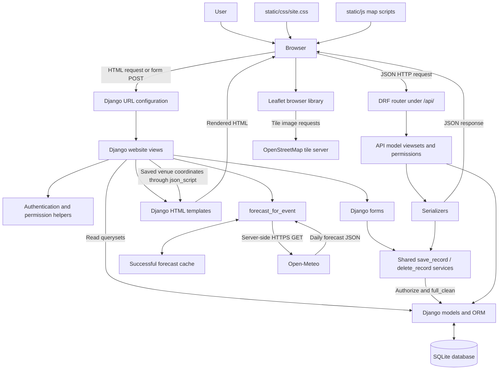
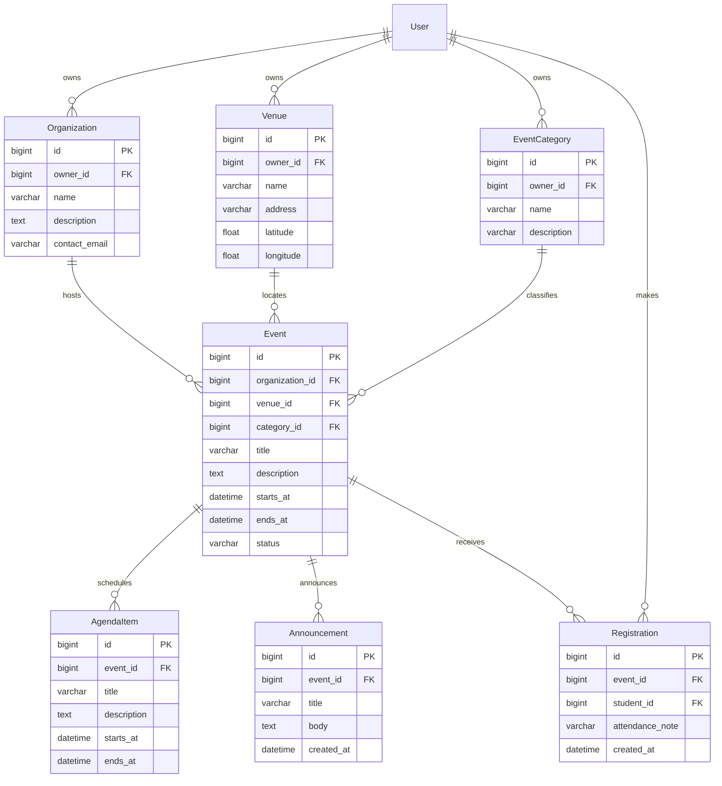

# CampusGather: complete source-code walkthrough

This guide teaches the application in `C:\Users\brene\Desktop\CampusGather`. It follows the actual Django models, URLs, views, forms, services, serializers, templates, JavaScript, and tests reviewed on 13 November 2026. Read a section with the named source file open in VS Code, then try the matching action with synthetic practice data.

The examples below describe the implementation, not additional features. Sample database IDs and JSON responses are **illustrative** unless explicitly described as a dated observation. Your IDs, dates, cookies, and passwords will differ. Do not type placeholders such as `<id>` literally into an address bar.

Verification has its own evidence trail. The original 65 tests passed again as the opening baseline. The final improved suite passed **87 tests in 42.152 seconds**, retaining the original tests and adding regressions. **See [IMPLEMENTATION_STATUS.md](../IMPLEMENTATION_STATUS.md)** for the review fixes, browser checks, dated live success and later provider timeouts, and remaining limitations. A documented command is not a claim that it was executed by this guide's author.

## How to study this guide

1. Read A and B to understand the purpose and request journey.
2. Read C and D with `events/models.py` and `events/permissions.py` open.
3. Perform E and F using synthetic practice records.
4. Learn G, H, and I as three different integrations: our own API, an external weather API, and a browser map.
5. Trace K line by line through the file inventory in J.
6. Use L and M to verify and rehearse your own environment.

Useful source entry points:

| Topic | Actual source |
|---|---|
| Database | [events/models.py](../events/models.py) |
| Website routes and views | [events/urls.py](../events/urls.py), [events/views.py](../events/views.py) |
| Forms and shared writes | [events/forms.py](../events/forms.py), [events/services.py](../events/services.py) |
| Roles and ownership | [events/permissions.py](../events/permissions.py) |
| REST API | [serializers.py](../events/api/serializers.py), [viewsets](../events/api/views.py), [API permissions](../events/api/permissions.py) |
| Weather and navigation | [weather.py](../events/weather.py), [navigation.py](../events/navigation.py) |
| Setup | [README.md](../README.md), [config/settings.py](../config/settings.py) |

## A. Project introduction

### What is CampusGather?

CampusGather is a campus event planner. A student can discover a campus event, read its schedule and announcements, locate its venue, check event-day weather, and keep a registration in one place. An organizer can maintain the records that make those pages possible. An administrator can manage users, organizer access, and application records.

The problem it addresses is fragmented event information. If dates, venue instructions, schedules, and participant lists live in separate messages or documents, students can miss updates and organizers can lose track of registrations. CampusGather stores related information in a database and presents it through consistent pages with controlled access.

The application's purpose supports the decision to build it: it combines a useful campus workflow with the course concepts of database relationships, CRUD, authentication, authorization, web requests, JSON APIs, and external services. This is an explanation of what the implemented project accomplishes; the code does not establish the team's personal history or a measured campus-wide impact study.

### Who uses it?

| User | Main capabilities |
|---|---|
| Visitor without an account | Browse public events and their visible details; read public API catalog information |
| Student | Visitor actions, signup/login, register as themselves, see their registrations, change an attendance note before the event starts, cancel a registration |
| Organizer | Student actions plus CRUD for their own organizations, venues, categories, events, agenda items, and announcements; read their own events' rosters |
| Application administrator | All organizer records, all registrations under the same timing rules, organizer role assignment; native Django user/group administration when permitted |

An organizer is still a Django user. It is a role granted through the `Organizers` group, not a separate user table. The application's administrator test is `is_superuser`; `is_staff` alone is not equivalent.

### What technologies are actually used?

| Technology | Job in this project |
|---|---|
| Python | Runs the server-side application code |
| Django 5.2.19 | Routing, views, templates, forms, ORM, authentication, sessions, admin, migrations, security middleware, test framework |
| Django REST Framework 3.18.3 | JSON serialization, model viewsets, router, permissions, paginated and browsable API |
| SQLite | Local relational database in `db.sqlite3` |
| HTML and Django Template Language | Structure pages and insert escaped server data |
| CSS | Layout, colors, responsive styling, focus states, maps, forms, buttons |
| Browser JavaScript | Initializes maps, selects coordinates, and handles map failures |
| Leaflet 1.9.4 | Browser library for interactive maps and markers |
| OpenStreetMap tile server | Supplies the visible map tile images and attribution source |
| Open-Meteo | Supplies daily weather forecasts through external HTTP requests |
| requests 2.34.2 | Python HTTP client used by `events/weather.py` |
| python-dotenv 1.2.4 | Loads local configuration from `.env` |

Python dependency versions above are the repository's `requirements.txt` pins, not a claim that they are the newest versions available. The project does not need Node.js or npm to run its application. Node can be used separately to check JavaScript syntax.

### Why Django fits this application

Django supplies several connected parts the project needs: a relational ORM, schema migrations, validated forms, password hashing, session login, CSRF protection, reusable templates, admin, and tests. That lets the implementation concentrate on event ownership, schedule rules, registrations, and integrations. Django REST Framework adds the seven-resource API while reusing the same models and write services.

### How the whole application works

A browser requests a URL. Django finds the corresponding view. The view checks who the user is, retrieves permitted records through the ORM, and renders an HTML template. A form submission follows a second request: the form validates input, a shared service authorizes and validates the complete record, and SQLite stores the change. Django redirects to a useful page after a successful HTML write.

The API follows a similar journey but uses a serializer instead of an HTML form and returns JSON instead of a full web page. Event details also call the server-side weather helper. The browser independently loads Leaflet and map tiles to draw the venue marker.

### A short answer for your professor

> “CampusGather is a Django campus event planner. Students discover events, read schedules and announcements, view the saved venue on a map, check an event-date forecast, and manage their registrations. Organizers manage their own event information, while administrators manage users and organizer access. The project uses seven related application models in SQLite, server-rendered pages, and seven REST API resources. Its main focus is keeping campus event information organized while enforcing permissions and validating changes.”

## B. Overall system architecture

### Architecture diagram



### Read the diagram step by step

1. **User and browser:** the user clicks an ordinary link or submits a form. The browser sends an HTTP request containing the path, query parameters, and possibly form data and cookies.
2. **URL configuration:** `config/urls.py` selects the broad area: `/admin/`, `/accounts/`, `/api-auth/`, `/api/`, or the event website. The included URL file matches the rest of the path.
3. **Website view:** a function in `events/views.py` or `accounts/views.py` makes the decision. For example, `event_detail(request, pk)` retrieves an event visible to this user.
4. **Identity and permission:** session middleware identifies the signed-in user; permission helpers decide which records and operations are allowed. A private draft is excluded before a public lookup succeeds.
5. **Database read:** an ORM queryset such as `visible_events(request.user)` produces SQL. SQLite returns matching rows and Django builds Python model objects.
6. **Database write:** a form or serializer first parses the input. `save_record` checks ownership, applies allowed fields, refreshes related objects, runs `full_clean()`, and saves inside a short transaction. `delete_record` authorizes deletion and handles protected relationships.
7. **HTML response:** `render()` combines a template with context values such as `event`, `weather`, or `back_url`. The browser receives ordinary HTML and then applies CSS and JavaScript.
8. **Our own API:** `/api/` uses viewsets and serializers. It exposes the same domain information as JSON and sends writes through the same service layer. It is not the Open-Meteo API.
9. **Weather:** Python requests one day's forecast from Open-Meteo, or reuses a recent validated successful forecast. Weather failure becomes a readable panel state rather than removing event details or registration controls.
10. **Map:** Django passes saved venue coordinates safely into HTML. Browser JavaScript asks Leaflet to create a map; Leaflet requests tile images from OpenStreetMap and draws a marker at the coordinates.

The server does not render the interactive map as a picture. The browser creates it after receiving the page. Conversely, the browser does not call Open-Meteo directly in the current code; the Python weather helper does.

### Django's model-template-view pattern in this repository

| Part | Meaning | CampusGather example |
|---|---|---|
| Model | Data structure and rules around a record | `Event` in `events/models.py` |
| Template | HTML presentation | `templates/events/event_detail.html` |
| View | Request-handling decision code | `event_detail` in `events/views.py` |
| URL | Connects a path to the view | `path("events/<int:pk>/", views.event_detail, name="event-detail")` |

Forms, serializers, permission helpers, and services keep additional responsibilities out of templates. A template can hide a button for usability, but server-side checks are still necessary because someone can send a request without clicking that button.

## C. Complete database explanation

### Essential terms before reading the models

A **table** stores records of one kind. A **row** is one record. A **field** is one value on a row, such as an event title. A **primary key** identifies a row uniquely. A **foreign key** stores a reference to a row in another table.

All seven application models inherit `models.Model`. Because they do not declare their own primary keys, `DEFAULT_AUTO_FIELD = "django.db.models.BigAutoField"` supplies an integer `id`. In Python, `obj.pk` refers to that primary key. The first row is not guaranteed to have ID 1; deletions and previous data change the sequence.

The default domain table names are `events_organization`, `events_venue`, `events_eventcategory`, `events_event`, `events_agendaitem`, `events_registration`, and `events_announcement`. Django auth, session, permission, content-type, migration, and admin tables are framework infrastructure. They do not change the count of seven principal application models.

`blank=True` means a form may accept an empty value. It is different from `null=True`, which permits SQL NULL. These optional text fields use empty strings; the source does not declare `null=True` for them. Only Registration and Announcement have `created_at` in the current domain schema.

### 1. Organization

**Purpose:** describes the campus group hosting events. Keeping this in its own table avoids repeating its name, description, and management contact on every event.

| Field | Django type | Meaning and important rule |
|---|---|---|
| `id` | Implicit `BigAutoField` | Primary key, generated by Django/database |
| `owner` | `ForeignKey(settings.AUTH_USER_MODEL, PROTECT)` | Required user who manages it; database column `owner_id`; reverse user relation `organizations` |
| `name` | `CharField(max_length=120)` | Required organization name |
| `description` | `TextField(blank=True, max_length=3000)` | Optional description |
| `contact_email` | `EmailField(blank=True)` | Optional management email; email validation; default maximum length 254 |

Organizations order by `name`, then `pk`. `__str__()` returns the name, so a dropdown can show a useful label instead of an object memory address.

**Relationship:** one user can own many organizations; one organization has one owner. One organization can host many events through `Event.organization`; `organization.events.all()` follows that reverse relation.

**Actual seed definition:** `seed_demo.py` creates or reuses `Demo: CampusGather Society`, owned by `demo_organizer`, description `A synthetic campus group for classroom demonstrations.`, and email `demo@example.test`. Existing matching rows retain user edits, so those are seed defaults rather than a promise about every local database.

**Website uses:** organizer Organizations CRUD, the Event organization dropdown, event host details, dashboard counts. The email is not shown on public event pages. The API returns it only to the owner or an administrator.

**CRUD:** add at `/manage/organizations/add/`; list and read at `/manage/organizations/` and `/manage/organizations/<id>/`; edit at `.../<id>/edit/`; confirm/delete at `.../<id>/delete/`. Deletion is protected while events reference the organization. API equivalent: `/api/organizations/` and its detail endpoint.

### 2. Venue

**Purpose:** stores where an event happens. The same saved coordinates drive the map and weather request.

| Field | Django type | Meaning and important rule |
|---|---|---|
| `id` | Implicit `BigAutoField` | Primary key |
| `owner` | `ForeignKey(User, PROTECT)` | Required manager; reverse relation `venues` |
| `name` | `CharField(max_length=120)` | Required venue name |
| `address` | `CharField(max_length=250)` | Required human-readable address |
| `latitude` | `FloatField(validators=[latitude])` | Required finite number between −90 and 90 |
| `longitude` | `FloatField(validators=[longitude])` | Required finite number between −180 and 180 |

`latitude()` and `longitude()` in `events/models.py` reject invalid/nonfinite values. Database constraints `venue_latitude_range` and `venue_longitude_range` also enforce the numeric ranges. Ordering is `name`, then `pk`.

**Relationship:** one user owns many venues. One venue can be used by many events; `venue.events.all()` retrieves them. A referenced venue cannot be deleted because `Event.venue` uses `PROTECT`.

**Actual seed defaults:** `Demo: Innovation Hall`, address `Example campus, Puerto Princesa, Palawan`, latitude `9.7392`, longitude `118.7353`; and `Demo: Campus Quadrangle`, address `Example campus grounds, Puerto Princesa, Palawan`, latitude `9.7398`, longitude `118.7360`. Both belong to `demo_organizer`. These are clearly synthetic examples, not verified real building locations.

**Website uses:** venue CRUD with a coordinate picker, Event venue dropdown, event address/marker, Open-Meteo request. Coordinates must be saved with the form; moving a marker alone does not write to SQLite.

**CRUD:** `/manage/venues/`, `/manage/venues/add/`, `/manage/venues/<id>/`, `.../edit/`, `.../delete/`; API `/api/venues/`. A venue in use by any event is protected from deletion.

### 3. EventCategory

**Purpose:** gives an event a classification and supports the website category filter.

| Field | Django type | Meaning and important rule |
|---|---|---|
| `id` | Implicit `BigAutoField` | Primary key |
| `owner` | `ForeignKey(User, PROTECT)` | Required manager; reverse relation `event_categories` |
| `name` | `CharField(max_length=80)` | Required category label |
| `description` | `CharField(max_length=250, blank=True)` | Optional short explanation |

Ordering is `name`, then `pk`. Its plural label is `event categories` in admin metadata.

**Relationship:** one owner has many categories; one category classifies many events through `Event.category`. An event has one category, not a list of tags.

**Actual seed defaults:** `Demo: Workshop` with description `Synthetic learning activities.` and `Demo: Community` with description `Synthetic campus gatherings.` Both are owned by `demo_organizer`.

**Website uses:** category CRUD, event category dropdown, event badges, discovery filter. Discovery offers categories belonging to events visible to the current user.

**CRUD:** `/manage/categories/`, `/manage/categories/add/`, `/manage/categories/<id>/`, `.../edit/`, `.../delete/`; API `/api/categories/`. Events referencing a category protect it from deletion.

### 4. Event

**Purpose:** the central activity that brings an organization, place, category, schedule, announcements, and registrations together.

| Field | Django type | Meaning and important rule |
|---|---|---|
| `id` | Implicit `BigAutoField` | Primary key |
| `organization` | `ForeignKey(Organization, PROTECT)` | Hosting organization; reverse relation `events` |
| `venue` | `ForeignKey(Venue, PROTECT)` | Saved location; reverse relation `events` |
| `category` | `ForeignKey(EventCategory, PROTECT)` | Classification; reverse relation `events` |
| `title` | `CharField(max_length=160)` | Required event title |
| `description` | `TextField(max_length=6000)` | Required event details |
| `starts_at` | `DateTimeField` | Start date and time |
| `ends_at` | `DateTimeField` | End date and time; must follow start |
| `status` | `CharField(max_length=12, choices=Status.choices, default="draft")` | `draft`, `published`, or `cancelled` |

Ordering is `starts_at`, then `pk`. `event_end_after_start` enforces `ends_at > starts_at` in SQLite. `Event.clean()` supplies additional application rules:

- A newly created event through the normal validated application workflow must start as a draft.
- Organization, venue, and category must belong to the same organizer.
- An existing event's organization cannot change.
- Draft may stay Draft, become Published, or become Cancelled. Published may stay Published or become Cancelled. Cancelled may only stay Cancelled.
- Changing the event's times must not leave existing agenda items outside the event window.

The `registration_open` property calculates a value; it is **not a stored column**:

```python
@property
def registration_open(self):
    return self.status == self.Status.PUBLISHED and self.starts_at > timezone.now()
```

Thus a published event that already started is closed even if its end time is still in the future. There is no participant-capacity field in this implementation.

**Ownership:** Event does not have an `owner` field. Its owner is `event.organization.owner`. This is why changing the organization would also change the ownership chain, and why that edit is prohibited.

**Actual seed definitions:**

| Title | First-creation start offset | Status | Venue/category defaults |
|---|---|---|---|
| `Demo: Campus Discovery Workshop` | Now + 2 days | Published | Innovation Hall / Workshop |
| `Demo: Green Campus Meetup` | Now + 5 days | Published | Campus Quadrangle / Community |
| `Demo: Draft Leadership Forum` | Now + 7 days | Draft | Innovation Hall / Workshop |
| `Demo: Cancelled Arts Night` | Now + 8 days | Cancelled | Campus Quadrangle / Community |
| `Demo: Future Research Showcase` | Now + 20 days | Published | Innovation Hall / Workshop |

All five belong to `Demo: CampusGather Society`; their seeded duration is two hours and their description is `Synthetic classroom example. No real event or attendee information.` Seed offsets are evaluated **only when a matching event is first created**. Rerunning the seed preserves dates and statuses. The seed is a controlled fixture command using `get_or_create`; do not copy it as the interactive write pattern or assume it changes the draft-first rule of `save_record`.

**Website uses:** discovery, search/filter, details, organizer event management, registration decisions, roster, weather target date, map location, agenda, announcements.

**CRUD:** public permitted read at `/events/<id>/`; organizer CRUD at `/manage/events/...`; API `/api/events/`. Deleting an event with registrations is protected. Without registrations, deletion cascades to its agenda and announcements. Cancelling an event changes `status` and retains those records; it does not delete the event.

### 5. AgendaItem

**Purpose:** stores an individual scheduled part of an event, such as an opening session.

| Field | Django type | Meaning and important rule |
|---|---|---|
| `id` | Implicit `BigAutoField` | Primary key |
| `event` | `ForeignKey(Event, CASCADE)` | Required parent; reverse relation `agenda_items` |
| `title` | `CharField(max_length=160)` | Required agenda heading |
| `description` | `TextField(blank=True, max_length=2000)` | Optional session details |
| `starts_at` | `DateTimeField` | Required session start |
| `ends_at` | `DateTimeField` | Required session end |

Ordering is `starts_at`, then `pk`. `agenda_end_after_start` is a database time-order check. `AgendaItem.clean()` also requires the agenda window to be fully inside its event window and prohibits changing its parent event after creation. Overlap between two agenda items is not prohibited by the current code.

**Relationship:** one event has many agenda items; each item belongs to one event. `event.agenda_items.all()` reads them. The owner is reached through `item.event.organization.owner`.

**Actual seed default:** each demo event gets `Demo: Opening session`, description `Welcome and introduction to the activity.`, starting at the event start and ending halfway through the event. For an unedited two-hour seeded event, this is a one-hour agenda item.

**Website uses:** “The schedule” on event details and organizer Agenda items CRUD. A draft's agenda is private along with the parent event.

**CRUD:** `/manage/agenda-items/...`; event details include Add agenda item, Edit, and Delete controls for authorized organizers. API `/api/agenda-items/`. Direct authorized deletion removes one item; deleting an unprotected parent event cascades to its items.

### 6. Registration

**Purpose:** records that one user registered for one event, plus their attendance note. It connects students and events and carries extra information about that connection.

| Field | Django type | Meaning and important rule |
|---|---|---|
| `id` | Implicit `BigAutoField` | Primary key |
| `event` | `ForeignKey(Event, PROTECT)` | Required registered event; reverse relation `registrations` |
| `student` | `ForeignKey(User, PROTECT)` | Required acting user; reverse relation `event_registrations` |
| `attendance_note` | `CharField(max_length=300, blank=True)` | Optional participation note |
| `created_at` | `DateTimeField(auto_now_add=True)` | Automatically set on first creation |

Ordering is newest creation first, then descending PK. `one_registration_per_student_event` is a database `UniqueConstraint` over `event` and `student`: one user cannot hold two registrations for the same event.

`Registration.clean()` prevents moving an existing registration to another event or student. Creating a registration and saving note changes require `event.registration_open`. Deletion uses `delete_record` rather than `Registration.clean`, so the owner or administrator may still cancel after an event starts or is cancelled.

`save_record` supplies the student from the signed-in user on creation. A client cannot enroll another account by submitting a `student` ID. This applies to an administrator as well: creation is for the acting administrator, not an “enroll anyone” form.

**Actual seed definition:** a first seed run with newly created students attempts workshop registrations for `demo_student` and `demo_student2`, and a meetup registration for `demo_student`, with note `Synthetic attendee: looking forward to the activity.` It only creates them while the event remains open. It never automatically enrolls pre-existing student accounts or recreates a previously cancelled registration on a rerun.

**Website uses:** Register, My registrations, detail, note edit, cancellation, organizer's read-only roster, administrator's All registrations. Public event pages show a registration **count**, not everybody's private notes.

**CRUD:** create through `/events/<event-id>/register/`; list/read at `/registrations/` and `/registrations/<registration-id>/`; update at `.../edit/`; delete at `.../cancel/`. Administrator list/detail/edit/delete paths start with `/manage/registrations/`. API `/api/registrations/` scopes rows to the user, plus own-event rosters for organizers, or all rows for an administrator.

### 7. Announcement

**Purpose:** an organizer's update associated with an event, displayed to permitted readers on that event page.

| Field | Django type | Meaning and important rule |
|---|---|---|
| `id` | Implicit `BigAutoField` | Primary key |
| `event` | `ForeignKey(Event, CASCADE)` | Required parent; reverse relation `announcements` |
| `title` | `CharField(max_length=160)` | Required announcement title |
| `body` | `TextField(max_length=3000)` | Required message text |
| `created_at` | `DateTimeField(auto_now_add=True)` | Automatically set on creation |

Ordering is newest creation first, then descending PK. `Announcement.clean()` prevents changing the parent event of an existing announcement.

**Relationship:** one event has many announcements; each announcement belongs to one event. Its owner is `announcement.event.organization.owner`.

**Actual seed default:** each demo event gets `Demo: Before you arrive`, with body `Check the event location and schedule. This is synthetic demonstration data.`

**Website uses:** “From the organizer” on event details and organizer announcement CRUD. It is a page update; there is no implemented email, push-notification, or social messaging delivery.

**CRUD:** `/manage/announcements/...`; authorized event-page Add/Edit/Delete controls; API `/api/announcements/`. A direct delete removes one announcement. An unprotected parent-event deletion cascades to announcements.

### ER diagram



`||--o{` means one row on the left may relate to zero or many rows on the right. A newly created event can have no agenda or registrations yet; each saved agenda/registration still requires its own parent event.

### One-to-one, one-to-many, and many-to-many in this project

- **One-to-one:** at most one row on each side. The seven application models contain no `OneToOneField` and there is no custom profile table. Do not draw an invented student-profile relationship.
- **One-to-many:** one organization hosts many events, while each event has one organization. These relationships are implemented with `ForeignKey` on the “many” side.
- **Many-to-many:** a student can register for many events and an event can have many students. CampusGather represents this logically through the explicit `Registration` junction model with two foreign keys and extra fields. It does not declare a domain `ManyToManyField`. Django's separate User–Group membership uses Django's built-in many-to-many relationship.

### How related data is read and protected

```python
event.organization.name       # Follow Event -> Organization.
event.venue.latitude          # Follow Event -> Venue -> one coordinate.
event.agenda_items.all()      # Reverse ForeignKey: all sessions of the event.
event.announcements.all()     # Reverse ForeignKey: event updates.
event.registrations.count()   # Count participant links.
```

An Event row stores `venue_id`, not a copied address. Reading `event.venue.address` follows the relationship to Venue. Updating that venue affects future reads for events sharing it; the current application does not keep a venue-address history snapshot.

`PROTECT` prevents deletion when referenced records need preservation. `CASCADE` removes dependent rows with their parent. If an event still has a Registration, the protected deletion fails as a whole; its agenda and announcements are not partly removed. `delete_record` turns that exception into a useful message/HTTP 409 response.

## D. Authentication and user permissions

### Account creation

`/accounts/signup/` routes to `accounts.views.signup`. `SignUpForm` in `accounts/forms.py` inherits Django's `UserCreationForm` and exposes `username`, `first_name`, `last_name`, and `email`, plus the inherited password fields. Password confirmation and configured Django password validators run during form validation. Django saves a **password hash**, not the typed password as plain text.

After a valid POST, `form.save()` creates an ordinary user and `login(request, user)` starts a session. The form does not expose `is_staff`, `is_superuser`, groups, or permissions. Submitting extra role fields cannot make a signup an administrator.

The optional `next` value is an authentication continuation. `signup` sends the user there only if `url_has_allowed_host_and_scheme` accepts the current host and, for HTTPS requests, a secure scheme. Otherwise it returns to `event-list`.

### Login, sessions, and logout

`accounts/urls.py` uses Django's `LoginView` at `/accounts/login/`, with `templates/registration/login.html`. Django checks the username and password hash through its authentication system. A successful login creates/updates server-side session state and gives the browser a session cookie. Later requests send that cookie; `SessionMiddleware` and `AuthenticationMiddleware` make `request.user` available.

Logout is a **POST** to `/accounts/logout/`, handled by Django's `LogoutView`. `templates/base.html` renders a small form containing ``. It clears the login session and redirects to discovery. A plain logout link issuing GET is not the implemented flow.

### Exact application role helpers

```python
def is_admin(user):
    return user.is_authenticated and user.is_superuser

def is_organizer(user):
    return user.is_authenticated and (
        is_admin(user) or user.groups.filter(name="Organizers").exists()
    )
```

These functions are in `events/permissions.py`. Every logged-in ordinary user can use the student features. An organizer also retains those capabilities. A superuser passes the organizer helper as well.

`is_staff` controls native Django admin entry along with active status and Django's permissions; it is not the application's administrator definition. An ordinary staff user does not gain the custom All registrations or Organizer access page simply by being staff.

### How organizer access is granted

A superuser opens `/accounts/roles/`. `accounts.views.roles` is login protected, checks `is_admin`, and gets/creates the group named exactly `Organizers`. A CSRF-protected POST supplies `user_id` and action `grant` or `revoke`. The view adds/removes that group and redirects back. Removing access retains owned records and registrations; it does not delete the user's data.

The role page does not create superusers. Use `createsuperuser` or the permitted native Django user-administration workflow for administrative access. Do not invite users to sign up as organizers through a hidden form field; that capability does not exist.

### Ownership checks and draft visibility

`can_manage(user, obj)` requires organizer access, permits a superuser, and otherwise follows this chain:

| Record | Ownership expression |
|---|---|
| Organization, Venue, EventCategory | `obj.owner_id` |
| Event | `obj.organization.owner_id` |
| AgendaItem, Announcement | `obj.event.organization.owner_id` |

`visible_events` returns all events for administrators; published/cancelled events for visitors/students; and those public events plus their own drafts for organizers. `managed_events` returns all events for an administrator, the organizer's own events for an organizer, and no events for a student.

HTML resource views first restrict their queryset with `resource_queryset`. A different organizer's record is usually absent and therefore returns 404. The service repeats authorization before writing. Filtered dropdowns are a usability and validation layer; they are not the only security layer.

### Registration privacy

`registration_queryset(user)` restricts the student's website pages to `student=user`. The organizer roster first restricts the event to `managed_events(user)`. A roster lets an organizer **read** their attendees and notes; it does not let them change another student's note or cancel that student's registration.

The administrator HTML routes call the same registration views with `admin_mode=True`; that requires `is_admin`. In the API, `RegistrationViewSet.get_queryset` returns the user's own registrations, plus registrations on the organizer's own events, or all registrations for a superuser. `RegistrationAccess.has_object_permission` still restricts writes to the registration's student or an administrator.

### Where unauthorized changes are stopped

1. `@login_required` stops anonymous access to protected website pages.
2. Role checks stop a student opening organizer/admin tools.
3. Scoped querysets avoid revealing private objects.
4. Form/serializer relationship choices reject foreign records.
5. `save_record` and `delete_record` check permissions again.
6. Model `clean()` checks immutable relationships and business rules.
7. Database foreign keys, unique constraints, and checks enforce stored integrity.
8. CSRF protection stops an unrelated page from submitting an authenticated unsafe request without the current token.

For example, changing the HTML `event` field of an existing agenda item cannot transfer it to another organizer: the choices, service permission chain, and `AgendaItem.clean()` all constrain the operation. Showing or hiding an Edit button is only the visible part of this protection.

## E. Every major website feature

Routes in this section are relative to `http://127.0.0.1:8000`. Route names such as `event-detail` are the names used by Django's `` tag and `reverse()`. A GET normally displays a page; a POST saves an HTML form or confirms deletion.

### Student and public pages

| Feature and where to click | URL → actual view | Data and operation | Result the user sees |
|---|---|---|---|
| Join CampusGather / Create a student account | `/accounts/signup/` → `accounts.views.signup` | `SignUpForm`; Django User; valid POST saves user and logs in | Welcome message and safe `next` destination or discovery |
| Log in | `/accounts/login/` → Django `LoginView` | Username/password validation and session | Signed-in navigation and safe continuation |
| Log out in header | POST `/accounts/logout/` → Django `LogoutView` | Invalidates login session; no event data deletion | Discovery as visitor |
| Discover events | `/` → `event_list` | `visible_events`; joins Venue/Organization/Category; counts Registration | Cards with dates, status/category, organizer, venue, registration count |
| Search and category dropdown | `/?q=workshop&category=<id>` → `event_list` | Case-insensitive match in title, description, organization name; validated category ID | Filtered cards or an empty state |
| Pagination | `/?q=...&category=...&page=2` → `event_list` | Django `Paginator`, nine events per page, start/PK ordering | Previous/Next and current page |
| View event / card title | `/events/<id>/` → `event_detail` | Permitted Event plus related Venue/Organization/Category | Description, schedule, announcements, location, registration controls, weather |
| The schedule | Same detail URL → `event_detail` | `event.agenda_items.all()` ordered by start/PK | Agenda titles/descriptions and Philippine times |
| From the organizer | Same detail URL → `event_detail` | `event.announcements.all()` newest first | Dated announcement headings and body text |
| Register for event | `/events/<id>/register/` → `registration_create` | `RegistrationNoteForm`; `save_record` assigns student and validates open event | Registration detail and success message; existing registration redirects to its detail |
| My registrations in header | `/registrations/` → `registration_list` | Own Registration queryset, 20 per page | Only the acting user's registrations |
| View a registration | `/registrations/<id>/` → `registration_detail` | Own Registration and related event/venue/student | Note, event, times, actions allowed by event state |
| Edit attendance note | `/registrations/<id>/edit/` → `registration_edit` | Only `attendance_note`; shared service validates full record | Updated detail after valid POST or validation error |
| Cancel registration | `/registrations/<id>/cancel/` → `registration_delete` → `delete_page` | Confirmation GET, authorized deletion POST | Confirmation before deletion, then own list and message |
| Event location | Event detail → template + `static/js/event-map.js` | Saved Venue coordinates in `map_data` | Leaflet marker/popup and address; textual fallback on failure |
| Event-day weather | Event detail → `forecast_for_event` | Event start date + Venue coordinates + cache/Open-Meteo | Real forecast or a specific unavailable state; registration still works |

The discovery search is not a full-text search engine and has no separate date-filter API. A malformed category value produces an empty result rather than a database integer-conversion crash. Malformed event-prefill IDs on child forms and malformed user IDs on the administrator role POST also return 404 rather than an unhandled conversion error.

### Organizer pages and catalog/event management

Open **Organizer desk** after the administrator grants organizer access. For a superuser the same dashboard is labelled **Administration**.

| Feature | URL → view | Model/read or save | Visible result |
|---|---|---|---|
| Organizer dashboard | `/organizer/` → `dashboard` | `managed_events`, Registration totals, resource counts | Six resource cards, event totals, published totals, recent managed events |
| Organizations card | `/manage/organizations/` → `resource_list` | Own Organizations, all for admin | Paginated management list with Add/View/Edit/Delete controls |
| Venues card | `/manage/venues/` → `resource_list` | Own Venues | Venue list and coordinate forms |
| Categories card | `/manage/categories/` → `resource_list` | Own EventCategories | Category list and forms |
| Events card | `/manage/events/` → `resource_list` | Managed Events | Private management list, including own drafts |
| Agenda items card | `/manage/agenda-items/` → `resource_list` | AgendaItems of managed events | Agenda management list |
| Announcements card | `/manage/announcements/` → `resource_list` | Announcements of managed events | Announcement management list |
| Add any of those six | `/manage/<resource>/add/` → `resource_form` | `form_for(model)` + `save_record` | Detail page after save; errors remain on form |
| View one resource | `/manage/<resource>/<id>/` → `resource_detail` | Fields declared in `services.FIELDS` | Record details and next-step actions |
| Edit one resource | `/manage/<resource>/<id>/edit/` → `resource_form` | Same form/service with existing instance | Saved detail or field/nonfield errors |
| Delete one resource | `/manage/<resource>/<id>/delete/` → `resource_delete` → `delete_page` | `delete_record` only on POST | Surviving list or protected-deletion message |
| Publish/cancel event | Event Edit form, same update URL | Event status and `Event.clean()` | Published becomes public/open if future; Cancelled remains visible but closed |
| Add agenda/announcement from event | `/manage/agenda-items/add/?event=<id>` or `/manage/announcements/add/?event=<id>` → `resource_form` | Authorized initial event selection; AgendaItem/Announcement | New child appears on event details |
| View roster | `/events/<id>/roster/` → `roster` | Managed Event and `registrations.select_related("student")` | Read-only attendee list with notes |

`events/resources.py::RESOURCES` contains exactly those six organizer resource keys. Registration has a different workflow because it belongs to the acting student rather than the organizer. There are still seven models and seven API resources.

The new-event form initially offers Draft only. Save, then choose Edit and publish when ready. A published event cannot be returned to Draft; cancel it if necessary. A cancelled event cannot reopen.

### Administrator features

| Feature | Where and request | Implementation and result |
|---|---|---|
| All domain management | Administration → six resource cards | Same resource views with administrator querysets; manage all owners' records while preserving ownership and relationship rules |
| All registrations | `/manage/registrations/` | `registration_list(admin_mode=True)`; all records instead of only own |
| Registration detail | `/manage/registrations/<id>/` | `registration_detail(admin_mode=True)` |
| Edit registration note | `/manage/registrations/<id>/edit/` | Same note form/service; note changes still require future published event |
| Delete registration | `/manage/registrations/<id>/delete/` | Confirmation and `delete_record`; authorized even when closed |
| Organizer access | `/accounts/roles/` | `accounts.views.roles`; grant/revoke exact `Organizers` group |
| User/group administration | `/admin/` → Users/Groups | Django's native admin and permissions; accounts/passwords/flags/groups are framework records |
| Inspect domain models in native admin | `/admin/events/` and its model pages when permitted | `events.admin.ApplicationDataAdmin` makes domain add/change/delete unavailable; use custom website/API for domain writes |

Native domain admin is deliberately read-only so its generic save/delete path cannot bypass the shared application's rules. Do not tell your professor that domain CRUD is performed through native Django admin; demonstrate the Administration dashboard instead.

### Safe Back buttons and breadcrumbs

Most HTML pages extend `templates/base.html`, which includes `events/includes/back_navigation.html` near the top. It renders an ordinary escaped `<a href="...">` with a decorative arrow and visible **Back** text. The discovery root does not need a link back to itself. Native admin and browsable API have separate minimal template overrides that include the same control; existing breadcrumbs remain.

The complete context comes from `events.context_processors.roles` and `events.navigation.navigation_context`. It supplies `back_url`, `show_back`, `return_to`, `event_parent`, `navigation_query`, and `origin_query`.

1. A list/card link carries its useful current path as encoded `return_to`.
2. `safe_destination` validates that candidate using the current host/HTTPS policy, a resolved named route, visibility/role checks, and bounded path/query rules.
3. It rejects external/protocol-relative/malformed URLs, control characters, backslashes, unknown routes, self destinations, login/logout and application create/edit/delete/confirmation targets, inaccessible objects, and incompatible role destinations. Native admin has its own explicit allowlist for permitted index/list/existing-object/history GET pages; an authorized user-change page can therefore be a valid admin parent.
4. Only useful list parameters survive: `q`, `category`, `page`, and native admin `p` under their validation limits. Nested `return_to` values are stripped; unrelated parameters are not propagated.
5. Without an accepted origin, `_parent` chooses a known parent. Direct event details go to discovery; resource lists go to dashboard; forms/details return to the appropriate resource or registration parent; API details return to their collection.
6. `return_field.html` carries the validated origin in HTML POST forms. It is revalidated when submitted; a hidden field is not trusted merely because the server originally rendered it.
7. `saved_detail_url` retains the list origin after a successful save. `surviving_list_url` returns to a compatible surviving list after deletion, rather than redirecting to the deleted object's detail.

Roster and event-prefilled agenda/announcement creation use the event detail as their immediate Back parent while carrying the accepted discovery origin on that event link. That preserves the useful sequence child page → event → original results.

Edit/delete actions opened on an event page separately carry a numeric `event_parent`. `event_parent_id` checks its size/range, organizer access and the record's actual event. A forged foreign, unrelated or malformed parent is ignored. `return_field.html` carries only the validated ID across a form POST; a successful save retains it. This gives Back/Cancel the immediate event parent while `return_to` still holds the flat list origin. Native admin catch-all URLs have no route name; `_admin_model` now explicitly rejects that case rather than calling a string method on `None`.

For example, opening an event from `/?q=campus&category=2&page=2` can return to those results. An edit form can Back to the record detail, which still remembers that list origin. Direct entry also works; it does not depend on `history.back()` or JavaScript.

The `next` login/signup continuation is distinct from `return_to`. The current helper does **not** treat the HTTP Referer as the authoritative Back destination. API JSON bodies are serializer input, not a channel for HTML navigation fields, so a JSON `return_to` is not an accepted resource field.

## F. CRUD in the actual application

### What CRUD means

| Operation | Plain meaning | Website request | API request |
|---|---|---|---|
| Create | Add a record | GET form, then POST valid values | POST collection |
| Read | Retrieve records | GET list/detail | GET collection/detail |
| Update | Change allowed values | GET edit form, then POST | PUT full required fields or PATCH selected fields |
| Delete | Remove a record if allowed | GET confirmation, then POST | DELETE detail |

Opening a Delete confirmation with GET does not remove a row. Cancel registration is a deletion of the Registration row. Cancel event is an update of Event.status. They are different operations.

### The shared write trace

For a normal organizer HTML save:

```text
events/urls.py: resource-create or resource-update
  -> events/views.py: resource_form
  -> events/resources.py: RESOURCES selects model
  -> events/forms.py: form_for -> ResourceForm -> is_valid()
  -> events/services.py: save_record(user, model, cleaned_data, instance)
  -> events/models.py: full_clean -> field validation + clean + constraints
  -> obj.save() -> SQLite
  -> saved_detail_url -> HTTP 302 -> GET resource detail
```

For a delete:

```text
resource-delete GET -> confirm_delete.html (row still exists)
resource-delete POST + CSRF -> delete_record -> permission check -> current.delete()
  -> success: HTTP 302 to surviving list
  -> protected FK: readable error, HTTP 409, nothing deleted
  -> exhausted SQLite lock wait: readable retry, HTTP 503
```

`save_record` starts `transaction.atomic()`, reloads an existing row, assigns ownership/student when creating, copies only the model's allowed `FIELDS`, refreshes related rows inside the write transaction, checks management permission, calls `full_clean()`, then saves. This matters because **Django's ordinary `obj.save()` does not automatically call `full_clean()`**. A direct ORM write in a shell may bypass application-only validation. Website and API writes use the service deliberately.

### Seven practical traces

| Model | Create and read example | Update trace | Delete trace and limitation |
|---|---|---|---|
| Organization | Organizer Add organization → POST `/manage/organizations/add/` → `resource_form` → `form_for(Organization)` → `save_record`; list/detail reads `resource_queryset` | Edit description/contact email → same view with instance; owner is retained | `resource_delete` → `delete_record`; protected if any Event references it |
| Venue | Add `Practice Hall` with address and both coordinates at `/manage/venues/add/`; same generic form/service; details display saved values | Click/drag marker or type new coordinates, then Save; finite/range validation in form/model/service | Same delete path; protected if any Event uses it |
| EventCategory | Add `Practice Workshop` at `/manage/categories/add/`; owner assigned by server | Edit name/description; same model service | Protected while an Event uses it |
| Event | Add with organization/venue/category owned by same organizer, start/end, and Draft at `/manage/events/add/`; management detail and public-permitted detail are separate reads | Edit title/time or publish/cancel; `Event.clean()` validates full state, immutable organization, agenda bounds | Protected while registrations exist; otherwise agenda/announcements cascade |
| AgendaItem | Event Add agenda item → `/manage/agenda-items/add/?event=<id>`; `resource_form` initializes permitted parent → `save_record` | Edit title/description/times within event; parent event cannot change | Direct authorized deletion of item; does not delete parent event |
| Registration | Student Register → POST `/events/<id>/register/` → `registration_create` → `RegistrationNoteForm` → `save_record`; student assigned from session | `/registrations/<id>/edit/` → `registration_edit`; only note form, up to 300 characters; event must be open | `/registrations/<id>/cancel/` → `registration_delete`/`delete_page`; student/admin may delete even after closure |
| Announcement | Event Add announcement → `/manage/announcements/add/?event=<id>` → `resource_form` → `save_record` | Edit title/body; `Announcement.clean()` keeps original parent | Direct authorized deletion; parent event remains |

Use a new synthetic practice event rather than editing another person's real schedule to prove these steps. Remove practice registrations before deleting their parent event, then remove unused catalog records if desired.

### What validates each kind of input?

- Django form/serializer fields validate required values, maximum text lengths, valid numbers, valid dates, emails, and related IDs.
- Role-scoped relationship choices prevent choosing another organizer's catalog rows.
- Model `clean()` validates combinations: event time order/owner alignment/status transitions, agenda bounds, immutable identities, registration open state.
- `full_clean()` also validates model fields, uniqueness, and applicable constraints before saving.
- Database constraints remain a last line for duplicate registration, basic time order, coordinate ranges, and relationships.
- API PATCH merges new values with the saved instance; the service then validates the **whole prospective object**, not only the submitted fragment.

For duplicate HTML registration, `registration_create` first redirects to an existing registration. If a duplicate reaches the shared service, validation/uniqueness protection still prevents a second row. The API reports duplicate input as 400 rather than silently adding a duplicate.

## G. The RESTful API

### Concepts in plain English

An **API** is a defined way for another program to request information or ask for a change. CampusGather's website is designed for people reading HTML; its own API presents the same domain as structured JSON. This makes the project demonstrable in a browsable interface or Postman and leaves a reusable programmatic interface. The code does not implement a separate mobile client.

**RESTful** here describes resource URLs and standard HTTP methods. A collection such as `/api/venues/` represents venues; a detail such as `/api/venues/102/` represents one venue. Permission checks still decide whether each caller can read or write. Because this project uses session authentication, it is not an implementation of a completely stateless, token-only architecture.

**JSON** is a text format for structured data. An object has key/value pairs, arrays have ordered values, strings use double quotes, and numbers do not. A JSON `null` is an absent value, different from `0` and from the string `"null"`.

An HTTP request has a method, URL, headers, possibly cookies, and sometimes a body. A response has a status, headers, and usually a body. An API's `201 Created` response is different from the website's `302` redirect after a successful form.

### Methods and actual endpoints

| Method | Apply to | Meaning |
|---|---|---|
| GET | Collection/detail | Read permitted records; does not create/delete |
| POST | Collection | Create one new record |
| PUT | Detail | Update using the full set of required writable fields |
| PATCH | Detail | Update only selected fields; whole resulting object still validated |
| DELETE | Detail | Remove that record if authorized and not protected |
| HEAD / OPTIONS | Supported by DRF | Response metadata / allowed-method and field information |

`events/api/urls.py` registers these seven viewsets with `DefaultRouter`; `config/urls.py` mounts it under `/api/`:

| Resource and model | Collection GET/POST | Detail GET/PUT/PATCH/DELETE | Serializer / viewset |
|---|---|---|---|
| Organization | `/api/organizations/` | `/api/organizations/<id>/` | `OrganizationSerializer` / `OrganizationViewSet` |
| Venue | `/api/venues/` | `/api/venues/<id>/` | `VenueSerializer` / `VenueViewSet` |
| EventCategory | `/api/categories/` | `/api/categories/<id>/` | `EventCategorySerializer` / `EventCategoryViewSet` |
| Event | `/api/events/` | `/api/events/<id>/` | `EventSerializer` / `EventViewSet` |
| AgendaItem | `/api/agenda-items/` | `/api/agenda-items/<id>/` | `AgendaItemSerializer` / `AgendaItemViewSet` |
| Registration | `/api/registrations/` | `/api/registrations/<id>/` | `RegistrationSerializer` / `RegistrationViewSet` |
| Announcement | `/api/announcements/` | `/api/announcements/<id>/` | `AnnouncementSerializer` / `AnnouncementViewSet` |

The API root is `/api/`; session login for its browsable HTML is `/api-auth/login/`. There is no implemented API token issuance, bearer-token authentication, API signup route, or API search/category filter. Website discovery supplies its own HTML search/filter. API collection pagination uses `?page=2` and a page size of 20.

Representative list response, here for venues:

```json
{
  "count": 1,
  "next": null,
  "previous": null,
  "results": [
    {"id": 102, "name": "Practice Hall", "address": "Example campus, Puerto Princesa", "latitude": 9.7392, "longitude": 118.7353}
  ]
}
```

### Serializers, viewsets, permissions, services

A **serializer** converts a model object into JSON-compatible values and checks incoming JSON. `ResourceSerializer.create/update` call `save_record`, so JSON and forms use the same authorization/model rules. `ResourceSerializer.to_internal_value` rejects unknown fields. It permits HTML form transport's `csrfmiddlewaretoken` only for HTML form input; that is not permission to put arbitrary metadata in JSON.

A **viewset** groups list/create/retrieve/update/delete actions. `ResourceViewSet` uses `SessionAuthentication`, delegates deletion to `delete_record`, and translates model validation to 400, protected deletion to 409, and exhausted write locks to 503.

`OrganizerWrites` allows safe reads and requires organizer access for unsafe operations on the six organizer resources. Owned resource viewsets scope write querysets to their owner, Event uses managed/visible event querysets, and child resources use their permitted parent events. `RegistrationAccess` requires login even to read registrations and restricts object writes to student/admin.

`owner` on Organization, Venue, and EventCategory is optional and **write-only**. Normally omit it; the service defaults to the acting organizer. An administrator can select an eligible organizer/admin when creating one. It is never returned, and existing ownership cannot change. `contact_email` is additionally removed from an Organization response for anyone other than its owner or an administrator.

`id`, Registration `student`, Registration `created_at`, and Announcement `created_at` are server-generated/read-only values. Omit them from create bodies. The code explicitly rejects attempts to conflict with read-only identities instead of relying on DRF silently ignoring them.

### Seven representative create/request/response examples

These are **serializer-based examples**, not captured live requests. IDs 101–107 are invented examples to make the relationships understandable. Read each actual returned `id` and use it in later requests. For dated bodies, replace the sample date with a real future Philippine date when you execute the demonstration. The following two-hour window is illustrative: `2026-11-15T09:00:00+08:00` to `2026-11-15T11:00:00+08:00`.

**1. Organization — organizer POST `/api/organizations/`:**

```json
{"name":"Practice Computing Society","description":"A synthetic practice organization.","contact_email":"practice@example.test"}
```

Representative `201 Created` body viewed by its owner:

```json
{"id":101,"name":"Practice Computing Society","description":"A synthetic practice organization.","contact_email":"practice@example.test"}
```

A visitor's GET of this record omits `contact_email`. Neither response includes `owner`.

**2. Venue — organizer POST `/api/venues/`:**

```json
{"name":"Practice Hall","address":"Example campus, Puerto Princesa","latitude":9.7392,"longitude":118.7353}
```

Representative `201`:

```json
{"id":102,"name":"Practice Hall","address":"Example campus, Puerto Princesa","latitude":9.7392,"longitude":118.7353}
```

**3. EventCategory — organizer POST `/api/categories/`:**

```json
{"name":"Practice Workshop","description":"A learning activity."}
```

Representative `201`:

```json
{"id":103,"name":"Practice Workshop","description":"A learning activity."}
```

**4. Event — organizer POST `/api/events/`:**

```json
{
  "organization":101,
  "venue":102,
  "category":103,
  "title":"Practice Python Workshop",
  "description":"A synthetic event for the API demonstration.",
  "starts_at":"2026-11-15T09:00:00+08:00",
  "ends_at":"2026-11-15T11:00:00+08:00",
  "status":"draft"
}
```

Representative `201`:

```json
{
  "id":104,"organization":101,"venue":102,"category":103,
  "title":"Practice Python Workshop",
  "description":"A synthetic event for the API demonstration.",
  "starts_at":"2026-11-15T09:00:00+08:00",
  "ends_at":"2026-11-15T11:00:00+08:00","status":"draft"
}
```

Then PATCH `/api/events/104/` with `{"status":"published"}`. A successful update returns 200 with the complete event representation and new status. New events cannot be created as Published through the API.

**5. AgendaItem — organizer POST `/api/agenda-items/`:**

```json
{"event":104,"title":"Opening practice session","description":"Introduction and exercises.","starts_at":"2026-11-15T09:00:00+08:00","ends_at":"2026-11-15T10:00:00+08:00"}
```

Representative `201`:

```json
{"id":105,"event":104,"title":"Opening practice session","description":"Introduction and exercises.","starts_at":"2026-11-15T09:00:00+08:00","ends_at":"2026-11-15T10:00:00+08:00"}
```

**6. Registration — signed-in student POST `/api/registrations/`:**

```json
{"event":104,"attendance_note":"I would like help with the beginner exercises."}
```

Representative `201` for a user whose illustrative ID is 42:

```json
{"id":106,"event":104,"student":42,"attendance_note":"I would like help with the beginner exercises.","created_at":"2026-11-13T14:30:00+08:00"}
```

The user ID and creation timestamp come from the server. PATCH `/api/registrations/106/` with `{"attendance_note":"I will arrive early."}` changes the note while open. DELETE the same URL cancels it and returns 204 with no response JSON.

**7. Announcement — organizer POST `/api/announcements/`:**

```json
{"event":104,"title":"Before you arrive","body":"Please check the saved venue and schedule."}
```

Representative `201`:

```json
{"id":107,"event":104,"title":"Before you arrive","body":"Please check the saved venue and schedule.","created_at":"2026-11-13T14:35:00+08:00"}
```

These examples also explain why foreign keys matter: the event body uses numeric IDs for Organization/Venue/Category, and the agenda, registration, and announcement use the Event ID. The server looks up those rows and checks they are permitted.

### Status codes and error examples

| Status | Meaning in CampusGather |
|---|---|
| 200 | Successful GET, PUT, or PATCH |
| 201 | New resource created |
| 204 | DELETE completed; empty body |
| 400 | Invalid values, duplicate registration, invalid relationships/times, unknown field, conflicting immutable identity |
| 403 | Authentication/role/object permission denied, or session CSRF failure |
| 404 | Missing row or row hidden by the caller's scoped queryset |
| 405 | This method is not allowed on that route, such as DELETE on a collection |
| 409 | Protected deletion, for example Event still has Registration rows |
| 503 | Shared service could not finish because SQLite remained busy |

Session-only authentication commonly returns 403 for unauthenticated protected requests; do not memorize 401 as every API's answer. Different protection layers can produce 400, 403, or 404 for different unauthorized inputs.

Representative validation error:

```json
{"ends_at":["End time must be after start time."]}
```

Cross-field model errors are converted to `non_field_errors`; permission/conflict errors commonly use `detail`. Exact wording can vary by the validation layer, but the status and fields show the category.

Representative protected-delete body:

```json
{"detail":"This record is in use. Remove its registrations or related events first; no data was deleted."}
```

### Demonstrating the browsable API

1. Run the project locally and open `http://127.0.0.1:8000/api/`.
2. Click a resource and show the list wrapper, JSON fields, and endpoint path.
3. Use Login at `/api-auth/login/` and sign in as an organizer for catalog/event writes. The HTML browsable form carries the CSRF token.
4. Create a clearly named synthetic category or organization. Explain the 201 response and returned ID.
5. GET its detail, PATCH an allowed field, then DELETE that unreferenced practice record.
6. Sign in as a student to show scoped registrations and a registration create/note/cancel example. Keep a future published practice event available.
7. Show an expected validation error, such as invalid time order or a duplicate registration. Explain why rejecting the request is correct behavior.

The Back override for browsable HTML preserves DRF's normal breadcrumbs. It does not add HTML navigation fields to JSON responses.

### Demonstrating Postman with SessionAuthentication and CSRF

Postman is an HTTP client; the application does not require Postman to run. Keep one hostname and port throughout. `localhost` and `127.0.0.1` are different cookie hosts.

1. Enable Postman's cookie jar. GET `http://127.0.0.1:8000/accounts/login/`. The response supplies a `csrftoken` cookie and hidden `csrfmiddlewaretoken` field.
2. POST to that same login URL using **x-www-form-urlencoded** fields `username`, `password`, and `csrfmiddlewaretoken` from the GET. Set `Referer` to the same-origin login URL. Enter your own local password privately.
3. Retain the response's session cookie. Login rotates the CSRF token, so inspect the **current** `csrftoken` cookie after login, not only the pre-login token.
4. GET `/api/registrations/` to check which user/session the request uses. An empty `results` can be a valid privacy result.
5. For POST/PUT/PATCH/DELETE API writes, send `X-CSRFToken: <current csrftoken>`, keep the cookies, and select `Content-Type: application/json` for JSON. For HTTPS, send a correct same-origin Referer as well.
6. Use the seven bodies above in dependency order, replacing IDs with returned values and dates with valid future values.
7. Read status and response body. A 403 may indicate role restrictions or CSRF; inspect its message. Do not disable CSRF or replace session authentication to bypass a failed demonstration.
8. Log out/clear cookies and refresh tokens before switching users. Do not share exported environments containing passwords, sessions, or tokens.

No Postman desktop execution is implied by this written procedure. The recorded verification source distinguishes Django APIClient tests, real browsable API checks, and any manual client work still to do.

## H. Weather integration

### What Open-Meteo does for CampusGather

Open-Meteo is the external weather provider contacted by `events/weather.py`. CampusGather stores event plans, not a global weather forecasting dataset. It therefore asks the provider for daily predicted conditions at the event's saved location and local calendar date.

Latitude measures north/south position, from −90 to 90; longitude measures east/west position, from −180 to 180. `9.7398, 118.7360` is a coordinate pair, not a date or address. Using the actual saved pair matters because a different location can have a different forecast.

The service endpoint is `https://api.open-meteo.com/v1/forecast`. Provider field names, timezone/date parameters, attribution, and forecast horizon were checked against the [Open-Meteo forecast reference](https://open-meteo.com/en/docs) during the improvement. CampusGather's own code deliberately accepts event dates at offsets 0 through 15 inclusive: today and the next fifteen dates. This is the implemented horizon, not a promise that every provider variable is always available for every location.

### Full event-detail request flow

```mermaid
sequenceDiagram
    participant Browser
    participant View as event_detail
    participant DB as Event and Venue
    participant Weather as forecast_for_event
    participant Cache
    participant Provider as Open-Meteo
    Browser->>View: GET /events/id/
    View->>DB: Query visible Event with Venue
    DB-->>View: Event.starts_at and saved coordinates
    View->>Weather: forecast_for_event(event)
    Weather->>Weather: Convert to configured timezone; validate date and coordinates
    alt Eligible target and valid location
        Weather->>Cache: Read parameter-derived key
        alt Cached successful result
            Cache-->>Weather: Validated forecast
        else No cached success
            Weather->>Provider: HTTPS GET one local event date
            Provider-->>Weather: HTTP response and daily JSON
            Weather->>Weather: Validate matching date, temperatures, code, optional rain
            Weather->>Cache: Save success for 900 seconds
        end
    else Past / too far / invalid location
        Weather->>Weather: Return distinct unavailable state; skip network
    end
    Weather-->>View: Forecast or readable state dictionary
    View-->>Browser: Event HTML including weather panel
```

1. The user opens `/events/<id>/`.
2. `event_detail` retrieves the visible Event and related Venue with `select_related`.
3. It calls `forecast_for_event(event)` and continues to provide event details, map data, and registration context regardless of the result.
4. The helper gets the configured timezone with `timezone.get_default_timezone()`. Current settings are `Asia/Manila`; both the event start and current time are converted explicitly before taking `.date()`.
5. It checks `(target - today).days`. Past and offset 16+ dates return distinct messages before any cache/HTTP request.
6. It reads `event.venue.latitude` and `longitude`, rejecting missing/non-numeric, boolean, nonfinite, or out-of-range values before network/cache use.
7. It builds a request for that exact date and saved pair, checks the success cache, and otherwise sends `requests.get` with separate connect/read timeouts.
8. HTTP errors, timeouts, connection failures, invalid JSON, and unusable payloads return a temporary state with a diagnostic reason.
9. `_daily_forecast` matches the requested date and validates essential measurements. It never substitutes today's weather for a missing event date.
10. A valid result is cached, then `templates/events/event_detail.html` displays date, condition text/icon, Celsius range, optional rain percentage, and fetch time.

### Actual request parameters and timeouts

The implementation builds the following dictionary; `target` is the event's configured-timezone date:

```python
params = {
    "latitude": latitude,
    "longitude": longitude,
    "daily": ",".join(DAILY_FIELDS),
    "timezone": settings.TIME_ZONE,
    "temperature_unit": "celsius",
    "start_date": target.isoformat(),
    "end_date": target.isoformat(),
}
response = requests.get(FORECAST_URL, params=params, timeout=(2, 3))
```

`DAILY_FIELDS` contains `temperature_2m_max`, `temperature_2m_min`, `precipitation_probability_max`, and `weather_code`. `start_date` and `end_date` being the same requests one local day. A timeout tuple means a 2-second connection timeout and 3-second read timeout; it is not a guaranteed five-second wall-clock deadline for every possible network path.

Only those weather parameters go to the provider. The request does not send the event title, student identity, registration note, or an application password. There is no weather API key in the current helper.

Timezone conversion matters near midnight. A stored `2026-11-14 17:30 UTC` is `2026-11-15 01:30` in Manila. The requested forecast date must therefore be November 15, not November 14. Django's timezone-aware dates and explicit use of `timezone.get_default_timezone()` implement that decision even when another timezone is temporarily active elsewhere. Django manages the configured default timezone; the helper does not construct its own separate timezone object.

### Understanding the JSON response

Representative provider payload, for explanation only:

```json
{
  "daily": {
    "time": ["2026-11-15"],
    "temperature_2m_min": [24.2],
    "temperature_2m_max": [31.6],
    "precipitation_probability_max": [30],
    "weather_code": [2]
  }
}
```

The arrays share indexes: index 0's date goes with index 0's temperatures, rain, and code. `_daily_forecast(payload, target)` requires exactly one matching target date, compatible required-array lengths, finite numeric minimum/maximum/code, minimum no greater than maximum, and a recognized `WEATHER_DESCRIPTIONS` code.

Code 2 maps to `Partly cloudy`; `_icon(2)` supplies the corresponding icon. A decorative icon is hidden from assistive technology while the condition text remains readable. This is formatting provider data, not deriving weather from the application's own AI or a stored sample.

Rain is **optional**. A missing `precipitation_probability_max` array, or a null value for the matched date, produces `rain_probability = None` while valid temperature and condition still display. The template then says rain probability is unavailable. If rain is supplied, the code requires the correct array shape and a finite value in 0–100. A real `0` displays as 0%; missing rain is never converted to zero.

### Cache implementation

```python
signature = json.dumps(params, sort_keys=True, separators=(",", ":"))
cache_key = "event-weather:v2:" + hashlib.sha256(signature.encode()).hexdigest()
cached = cache.get(cache_key)
if cached is not None:
    return cached
# ... fetch and validate ...
cache.set(cache_key, result, timeout=900)
```

A cache is a temporary copy that saves repeating work. Here the key includes the date, both coordinates, timezone, units, and requested fields through the normalized parameter signature. Changing the venue coordinates or event date changes the key. Two events with the same weather request can reuse a result; an event ID alone would not express the necessary identity.

Only successes are cached for 900 seconds, or 15 minutes. Failures are retried on a later visit. Past/horizon checks happen before cache lookup, so yesterday's event cannot reuse an old success as a future forecast. Prefix `v2` separates the improved result contract from old cached shapes.

No custom `CACHES` backend is configured in `settings.py`, so Django's default local-memory cache is used. It is process-local, disappears with process restarts, and is not a persistent Weather table or a shared Redis service. `fetched_at` is the actual retrieval time stored with the result; it differs from the forecast's event date.

### The five user-facing weather states

| `state` | When | User meaning / network behavior |
|---|---|---|
| `available` | Valid cached or fetched forecast | Show forecast date, description/icon, min/max °C, optional rain, fetch time |
| `past` | Event local date before today | Future forecast no longer available; no provider request |
| `out_of_range` | Event local date offset ≥16 | Forecast not yet available; check closer to event; no provider request |
| `invalid_location` | Eligible date but bad saved coordinates | Organizer needs to correct venue location; no provider request |
| `temporarily_unavailable` | Timeout/network/HTTP/JSON/required-payload problem | Provider response currently unusable; try later; no fabricated measurements |

Internal `reason` values further distinguish `timeout`, `connection_error`, `http_error`, `request_error`, `invalid_json`, and `invalid_payload`. `_provider_failure` logs reason, target date, and HTTP status when present, without event titles or registration data. The order is intentional: a past event returns `past` before its coordinates are considered.

The panel always retains source links to [Open-Meteo](https://open-meteo.com/) and [CC BY 4.0](https://creativecommons.org/licenses/by/4.0/), and explains that daily values/icons are formatted by CampusGather. The page says forecasts may change. See the provider's [licence](https://open-meteo.com/en/licence) and [terms](https://open-meteo.com/en/terms) for its service conditions.

### What was actually found about the screenshot

The screenshot's generic “temporarily unavailable” message did not preserve the exact HTTP response, timing, or cache entry from the moment it was taken. A later request cannot prove which transient failure happened earlier. On 13 November 2026, exact-parameter live requests for the two saved demonstration targets returned HTTP 200 with payloads accepted by the **old** parser. The historical screenshot failure was therefore not reproduced in that observation; it would be inaccurate to say the screenshot proves a bad date, invalid coordinates, or a particular timeout.

Source inspection and controlled regression checks did establish an independent parser defect: the old implementation required usable rain values even when required date, temperature, and condition values were valid. That made a partially available provider response unnecessarily become a generic failure. The improved parser preserves the real forecast when rain is unavailable, adds explicit state/reason reporting, validates location, uses the configured timezone explicitly, and retains successful-response caching. It does not claim that this confirmed defect caused the historical screenshot.

The existing `Demo: Green Campus Meetup` was already saved for 16 November 2026 and eligible on November 13, so no seed or existing event dates were changed to manufacture a demonstration. The updated helper genuinely retrieved an available November 16 forecast during the improvement: minimum 24.6 °C, maximum 29.8 °C, rain 87%, Light drizzle. **That is one dated live observation, not fixture data or a guarantee of the next response.** See the final status file for its precise recorded context.

Automated weather tests use controlled payloads and a mocked clock/HTTP client. They prove decisions and parsing for known cases; they do not prove current Open-Meteo availability. During a later defense, choose a future published event within the current local 0–15-day horizon and show the current live result or the honest state message.

## I. Map integration

### Leaflet and OpenStreetMap are different parts

**Leaflet.js** is a JavaScript library: it supplies map controls, marker behavior, popups, dragging, and events. **OpenStreetMap** is a map-data project; this application loads rendered tile images from `https://tile.openstreetmap.org/{z}/{x}/{y}.png`. Leaflet is the drawing/interaction tool, while the tile server supplies the background images.

A **tile** is a small square image for a particular zoom and map position. `{z}`, `{x}`, and `{y}` are replaced with tile coordinates. Several adjacent tiles form the map visible in the browser. The database does not store all those images; it stores the venue's numeric location.

`templates/events/includes/leaflet_css.html` and `leaflet_js.html` load version 1.9.4 from a CDN with integrity hashes and `crossorigin`. Map and weather need external services, but a failed tile/CDN request does not remove the saved address or disable core event forms.

### Organizer coordinate selection

1. Open `/manage/venues/add/` or `/manage/venues/<id>/edit/`.
2. `resource_form` sets `is_venue=True`, so `resource_form.html` includes the map container and `static/js/venue-map.js`.
3. The script finds `#venue-map`, `#id_latitude`, `#id_longitude`, and `#map-feedback`.
4. `coordinatesFromInputs()` checks both fields and numeric ranges. With saved coordinates, Leaflet centers there at zoom 16 and places a draggable marker.
5. With no selected coordinates, the map shows the Philippines at `[12.8797, 121.774]`, zoom 5. **This overview is not a default saved venue location.** The fields remain required.
6. Clicking the map calls `updateInputs(event.latlng)`. Dragging the marker calls the same function on `dragend`. It writes six-decimal coordinates to the inputs, moves the marker, and updates feedback.
7. Typing coordinates triggers `updateFromInputs()`, moving the marker for valid input or removing it if input is invalid. Numeric fields are a usable keyboard alternative to clicking the map.
8. Save submits the ordinary HTML venue form. Only then do form/model/service validation and SQLite persistence happen.

If Leaflet cannot load, `unavailable()` displays text and leaves the coordinate fields usable. `tileerror` also changes feedback. It does not invent coordinates or silently save the Philippines overview.

### Saved Venue to the student's marker

Actual server context in `event_detail` includes:

```python
"map_data": {
    "latitude": event.venue.latitude,
    "longitude": event.venue.longitude,
    "name": event.venue.name,
    "address": event.venue.address,
}
```

The template uses Django's safe JSON mechanism:

```django
{{ map_data|json_script:"event-map-data" }}
```

`static/js/event-map.js` reads that element's `textContent`, calls `JSON.parse`, validates the numeric pair, then initializes:

```javascript
const map = window.L.map(container, { scrollWheelZoom: false })
  .setView([latitude, longitude], 16);
```

It adds the OpenStreetMap tile layer, then a marker at `[latitude, longitude]`. A popup is a small information bubble attached to the marker. The script creates DOM elements for venue name/address, sets their **`textContent`**, and calls `bindPopup(popup)`. It does not concatenate user-entered venue text into raw HTML.

Students can open the marker popup and use the zoom controls; they cannot change the saved venue by moving around the event map. The organizer picker is the editing surface. Visible attribution credits OpenStreetMap contributors in both the tile layer and the page.

If JavaScript/CDN/tiles fail, the page still lists the venue name, address, latitude, and longitude. That is a deliberate fallback, not proof the external map service is currently reachable. The project does not implement geocoding an address, route directions, GPS tracking, or automatic location detection.

## J. Project folders and important files

Paths in the inventory are relative to `C:\Users\brene\Desktop\CampusGather`.

| Folder/file | Actual responsibility and important names |
|---|---|
| `manage.py` | Entry point for Django commands: runserver, migrate, test, check, seed_demo, createsuperuser |
| `requirements.txt` | Pinned Python dependencies; no frontend npm build requirement |
| `README.md` | Setup, roles, feature paths, demo-data rules, troubleshooting, guide links |
| `IMPLEMENTATION_STATUS.md` | Dated evidence: actual automated/browser/live checks and limitations |
| `.env.example` | Configuration template for a new local environment |
| `.env` | Private local configuration; do not commit, print, or distribute its contents |
| `.venv/` | Local Python interpreter and installed dependencies; generated for each computer |
| `db.sqlite3` | Local application database; not a source file to edit or a file to reset for a demo |
| `config/settings.py` | Installed apps, middleware, database, timezone, templates/static, authentication redirects, REST settings, environment-derived security configuration |
| `config/urls.py` | Mounts admin, account URLs, browsable API auth, API router, event website |
| `config/asgi.py`, `config/wsgi.py` | Django server/application entry points for ASGI/WSGI hosting |
| `accounts/apps.py` | Django app configuration |
| `accounts/models.py` | No custom principal account model; uses configured Django User |
| `accounts/forms.py` | `SignUpForm`, based on `UserCreationForm` |
| `accounts/views.py` | `signup`, `roles`; safe authentication continuation and organizer grants |
| `accounts/urls.py` | LoginView, LogoutView, signup, roles routes |
| `accounts/admin.py` | Account app admin module; built-in User/Group administration comes from Django auth |
| `accounts/tests.py` | `AccountTests`: safe signup/login/logout, privilege spoofing rejection, CSRF/protected access |
| `accounts/migrations/` | App migration package; no separate profile schema in the reviewed implementation |
| `events/apps.py` | Events app configuration |
| `events/models.py` | All seven models; coordinate validators, `Event.registration_open`, model `clean()` methods and constraints |
| `events/migrations/0001_initial.py` | Versioned initial database schema for those models and constraints |
| `events/resources.py` | `RESOURCES`: six generic organizer resource keys, labels, descriptions, and model mappings |
| `events/forms.py` | `ResourceForm`, `form_for`, `RegistrationNoteForm`; owner/event choice scoping and datetime-local widgets |
| `events/permissions.py` | `is_admin`, `is_organizer`, `visible_events`, `managed_events`, `can_manage` |
| `events/services.py` | `FIELDS`, `OWNED_MODELS`, `save_record`, `delete_record`, `ProtectedDeletion`, `TemporarilyBusy`; shared authorized writes |
| `events/views.py` | `event_list`, `event_detail`, `dashboard`, resource CRUD, registration CRUD, `roster`, helper querysets/error handling |
| `events/urls.py` | Named website route patterns |
| `events/navigation.py` | `safe_destination`, `return_destination`, `event_parent_id`, `with_return_to`, `saved_detail_url`, `surviving_list_url`, `navigation_context`; internal route/visibility/parent helpers |
| `events/context_processors.py` | `roles`: supplies role flags and navigation context to templates |
| `events/weather.py` | `forecast_for_event`, `_daily_forecast`, `_finite_number`, `_icon`, `_unavailable`, `_provider_failure`; provider request, parsing, states, icons, cache |
| `events/admin.py` | `ApplicationDataAdmin`; registers seven models as domain read-only in native admin |
| `events/api/urls.py` | `DefaultRouter` registers seven API resources |
| `events/api/serializers.py` | `ResourceSerializer`, `OwnedSerializer`, `EventChildSerializer`, seven model serializers; validation and representation |
| `events/api/views.py` | Shared and seven concrete ModelViewSets; querysets, SessionAuthentication, error mapping, service deletion |
| `events/api/permissions.py` | `OrganizerWrites`, `RegistrationAccess` |
| `events/management/commands/seed_demo.py` | `Command.handle` and `example`; transactional, repeat-safe synthetic examples and new-account password validation |
| `events/tests/test_website.py` | HTML feature and authorization/integrity tests |
| `events/tests/test_api.py` | Seven API CRUD resources, privacy, relation identity, CSRF, errors, browsable forms |
| `events/tests/test_rules.py` | Shared-service business-rule tests |
| `events/tests/test_concurrency.py` | Competing real SQLite transactions and consistency checks |
| `events/tests/test_seed.py` | Password/account/data preservation and cancelled-registration seed behavior |
| `events/tests/test_weather.py` | Controlled clock/provider/cache tests; no live network dependency |
| `events/tests/test_navigation.py` | Safe Back destinations, context retention, direct-entry role matrix, HTML/API invariance, forecast rendering |
| `templates/base.html` | Shared shell: CSS, main/account navigation, skip link, shared Back, messages, content/footer blocks |
| `templates/events/event_list.html` | Discovery search/filter, event cards, pagination, empty state |
| `templates/events/event_detail.html` | Details, agenda, announcements, organizer controls, registration, map, five-state weather display |
| `templates/events/dashboard.html` | Organizer/admin dashboard and resource/people actions |
| `templates/events/resource_list.html` | Generic management list for six organizer resources |
| `templates/events/resource_detail.html` | Generic field/detail display and next actions |
| `templates/events/resource_form.html` | Generic create/edit form and venue coordinate picker |
| `templates/events/confirm_delete.html` | Confirmation page and protected/busy error display; CSRF POST |
| `templates/events/registration_list.html` | Own/all registration list according to context |
| `templates/events/registration_detail.html` | Registration details, timing state, note/cancel links |
| `templates/events/registration_form.html` | Registration creation/note edit and closed-state rendering |
| `templates/events/roster.html` | Authorized organizer read-only participant list |
| `templates/events/includes/` | Shared event card, pagination, field errors, Leaflet includes, Back control/styles, hidden return field |
| `templates/registration/login.html` | Website login form using Django authentication |
| `templates/accounts/signup.html`, `roles.html` | Signup and administrator organizer-role screen |
| `templates/admin/base_site.html` | Native admin extension adding the shared Back control without replacing Django admin behavior |
| `templates/rest_framework/api.html`, `login.html` | Browsable API/auth extensions adding Back while keeping DRF blocks |
| `templates/403.html`, `404.html`, `500.html`, `errors/error.html` | Consistent error pages; actual debug-mode 500 behavior also depends on Django settings |
| `static/css/site.css` | Visual system, responsive breakpoints, forms, tables, cards, focus and map styling |
| `static/js/venue-map.js` | Coordinate picker; marker/input synchronization and fallback |
| `static/js/event-map.js` | Read-only event location marker, safe text popup, tile/CDN fallback |
| `static/icon.svg` | Local favicon |
| `staticfiles/` if collected | Generated static deployment output from collectstatic; source lives in static/ |
| `docs/` | Learning, API, database, demo, requirement, presentation, and plan documents |
| `docs/plans/2026-11-13-1232-fix-navigation-weather-teaching-plan.md` | Implementation requirements, decisions, and verification contract for this improvement |
| `output/` and `.playwright-cli/` | Local browser evidence/tool artifacts where present; not application business logic |
| `.gitignore` | Excludes appropriate local/generated/private files from version control |

There is no standalone `events/tests.py` because tests are split into the `events/tests/` package. API serializers live in `events/api/serializers.py`, not a root `events/serializers.py`. `services.py` is the shared write layer; `weather.py` is the external forecast layer. Using their real paths helps you find the correct code during a defense.

### The files working together in one example

For an event edit, `config/urls.py` includes `events/urls.py`; the matched route calls `resource_form` in `events/views.py`. `resources.py` selects Event, `forms.py` builds a model form, `permissions.py` restricts choices/records, and `services.py` authorizes and validates the write using `models.py`. The template supplies an HTML form and CSRF token, `navigation.py` supplies a safe return destination, and a successful save redirects to a detail template styled by `site.css`. Migration files explain how the matching database tables were created; tests independently verify the behavior.

## K. Eleven complete workflow traces

In each trace, the browser's cookie identifies the acting user after login. The view never trusts a client-provided role. All POST forms include CSRF protection. Commands for starting the server are in M.

### 1. A student creates an account

1. Click Join CampusGather. Browser GET `/accounts/signup/` reaches `config/urls.py` → `accounts/urls.py` → `accounts.views.signup`.
2. `SignUpForm` is unbound on GET; `templates/accounts/signup.html` renders fields and CSRF token.
3. Enter username/profile fields and matching passwords, then submit POST to the same URL.
4. The form checks uniqueness/fields/passwords with Django validation. Invalid input re-renders the form with errors; no user is created by that failed submission.
5. `form.save()` creates Django User with hashed password; no organizer group/superuser flag is granted.
6. `login(request, user)` creates the session. A message welcomes the student.
7. A valid same-site `next` is used; otherwise `redirect("event-list")` sends a 302 to `/`, followed by a new GET.

**Files:** `accounts/urls.py`, `accounts/views.py::signup`, `accounts/forms.py::SignUpForm`, `templates/accounts/signup.html`, `config/settings.py` auth/middleware.

### 2. A student finds an event and opens details

1. Browser GET `/?q=campus&category=<id>&page=1` reaches `events.views.event_list`.
2. `visible_events` excludes unauthorized drafts. `select_related` retrieves related catalog rows and `Count("registrations")` provides totals.
3. Search matches title/description/organization; a valid category ID restricts the queryset. `Paginator(..., 9)` chooses a page.
4. `event_list.html` renders `includes/event_card.html`. Card links encode the filtered path in `return_to`.
5. Click View event → GET `/events/<event-id>/?return_to=<encoded-list-path>`.
6. `event_detail` again retrieves from `visible_events`, gathers agenda, announcements, current user's registration, weather, and `map_data`.
7. `event_detail.html` displays the related data. `navigation_context` validates the origin; Back restores the accepted filters/page.

**Files:** `events/urls.py`, `views.py::event_list/event_detail`, `permissions.py::visible_events`, `navigation.py`, discovery/card/detail templates.

### 3. A student registers for an event

1. From a future Published event, click Register for event. If anonymous, first follow login with safe `next` continuation.
2. GET `/events/<event-id>/register/` reaches login-protected `registration_create`; it finds a visible event and checks for an existing registration.
3. An existing row redirects to its detail. Otherwise `RegistrationNoteForm` renders an optional note.
4. POST the note and CSRF token. Closed registration produces an error; valid input calls `save_record(request.user, Registration, {"event": event, ...})`.
5. The service assigns `student=request.user`, refreshes the Event inside the transaction, checks `Registration.clean()` and uniqueness, then saves.
6. Successful POST redirects to `/registrations/<registration-id>/`, preserving accepted navigation origin.
7. Detail shows the registered user, event, note, timestamps, and edit/cancel actions. The event's registration count increases.

**Files:** `views.py::registration_create`, `forms.py::RegistrationNoteForm`, `services.py::save_record`, `models.py::Registration`, registration form/detail templates.

### 4. An organizer creates an event

1. Sign in as an organizer. Open Organizer desk `/organizer/`; `dashboard` requires `is_organizer`.
2. Ensure an organization, venue, and category owned by that organizer already exist; create them through their resource cards if needed.
3. Click Create an event → GET `/manage/events/add/` → `resource_form` → `form_for(Event)`.
4. `ResourceForm` restricts relation dropdowns to that organizer and offers Draft only. Enter title/description and Philippine start/end values.
5. POST validates the form. `save_record` refreshes related records, checks permission, `Event.full_clean()` checks all rules, and SQLite saves the draft.
6. A 302 takes the browser to `/manage/events/<id>/`. The draft is visible to its organizer and administrators but absent from other users' public lists/API.
7. Click Edit, choose Published, and save. The valid transition makes it visible publicly. Registration is open only if the start remains in the future.

**Files:** `resources.py`, `views.py::resource_form`, `forms.py::ResourceForm/form_for`, `services.py`, `models.py::Event`, resource templates.

### 5. An organizer adds an agenda and announcement

1. Open the organizer's event detail or management detail. Ownership enables the Add agenda item / Add announcement controls.
2. Agenda link GET `/manage/agenda-items/add/?event=<event-id>` initializes an authorized parent through `managed_events`.
3. Enter title and times inside the event window; POST runs form and shared-service validation. `AgendaItem.clean()` rejects an out-of-bounds session.
4. A saved AgendaItem references the Event by `event_id`. Returning to event details retrieves it through `event.agenda_items.all()`.
5. Announcement link GET `/manage/announcements/add/?event=<event-id>` follows the same generic form path with `Announcement`.
6. POST title/body; the service saves and sets `created_at` automatically through the model field.
7. Returning to event details retrieves newest announcements first. Existing child records cannot be reassigned to another event through edit.

**Files:** event/resource detail templates, `views.py::resource_form`, `forms.py`, `models.py::AgendaItem/Announcement`, `services.py`.

### 6. An organizer creates a venue and saves coordinates

1. Organizer desk → Venues → Add venue → GET `/manage/venues/add/`.
2. `resource_form` builds `form_for(Venue)` and renders the venue-specific map area.
3. Leaflet/`venue-map.js` shows the Philippines overview without committing a location. Click a location, drag the marker, or enter latitude/longitude manually.
4. The script updates the form inputs and feedback; this is browser state only.
5. Submit POST with name, address, latitude, longitude, and CSRF token.
6. Form and model validators check required fields, finite numeric coordinates, and ranges; `save_record` assigns the acting owner and saves atomically.
7. Detail displays the saved record. Events using that Venue subsequently use those same saved values for map and weather.

**Files:** `views.py::resource_form`, `forms.py`, `templates/events/resource_form.html`, Leaflet includes, `static/js/venue-map.js`, `models.py::Venue`, `services.py`.

### 7. A student views the event location

1. Student GET `/events/<id>/` passes event visibility lookup.
2. `event_detail` reads the related Venue and puts its pair/name/address in `map_data`.
3. The template prints the address/coordinates and serializes the mapping through `json_script` into `#event-map-data`.
4. Browser loads Leaflet and `event-map.js`; it parses and validates the JSON pair.
5. Leaflet creates the map and requests OSM tile images. A marker uses the exact pair; its popup contains safe text nodes for name/address.
6. Student opens the popup/zooms. These actions do not send a database update.
7. If assets/tiles fail, feedback explains the issue and the printed location/registration controls remain available.

**Files:** `views.py::event_detail`, `event_detail.html`, `event-map.js`, Leaflet includes, `Venue`.

### 8. Weather fetches and displays an event-date forecast

1. Event detail lookup supplies Event and Venue to `forecast_for_event`.
2. Convert `starts_at` and current time using configured Asia/Manila; determine target date and day offset.
3. Past or offset 16+ returns its own state. An eligible event with invalid coordinates returns `invalid_location`.
4. For valid input, build exact single-day parameters and their SHA-256 cache key.
5. A cache hit returns the previous validated result. A miss sends HTTPS GET to Open-Meteo with `(2, 3)` timeouts.
6. Validate HTTP status/JSON and matching date, required arrays/values, recognized condition, optional valid rain. Any failure returns a diagnostic temporary state.
7. Cache a success for 900 seconds. Template displays the real event-date forecast and attribution, or a state-specific explanation without fake values.

**Files:** `events/weather.py`, `views.py::event_detail`, `event_detail.html`, `config/settings.py::TIME_ZONE`; weather tests for controlled proof.

### 9. A student edits a registration note

1. My registrations → detail → Edit attendance note → GET `/registrations/<id>/edit/`.
2. `registration_edit` gets the row from `registration_queryset(request.user)`; another student's row is absent.
3. `RegistrationNoteForm(instance=obj)` exposes only `attendance_note`, not student/event identity.
4. POST checks length and other form validation. `save_record(..., instance=obj)` refreshes the row/event and rechecks permissions/open state.
5. `Registration.clean()` prevents note changes if the event started or is cancelled; changing a hidden field cannot bypass that rule.
6. Success saves the same row, redirects to registration detail, and retains useful Back context. `created_at` remains the original creation time.

**Files:** registration routes, `views.py::registration_edit/registration_queryset`, `RegistrationNoteForm`, `Registration.clean`, `save_record`, registration templates.

### 10. A student cancels a registration

1. Click Cancel registration on own detail → GET `/registrations/<id>/cancel/`.
2. `registration_delete` scopes the row to the student and calls `delete_page`.
3. `confirm_delete.html` asks for confirmation; GET has not deleted anything. Back/Cancel returns to a useful detail parent.
4. Confirm with CSRF-protected POST. `delete_record` reloads the current row inside a transaction and allows its student or an administrator.
5. Registration is deleted even when note edits are closed. This does not cancel/delete the Event.
6. The redirect uses `surviving_list_url` to return to the own-registration list, preserving compatible list pagination.
7. The event's count decreases. A later seed rerun does not recreate that cancelled registration for an existing student.

**Files:** `views.py::registration_delete/delete_page`, `services.py::delete_record`, confirmation template, `navigation.py`, seed preservation logic/tests.

### 11. An API request creates a record

Example: create an unreferenced practice category as an organizer.

1. Establish a valid session and CSRF token through browser login or the Postman sequence in G.
2. Send POST `/api/categories/` with JSON `{"name":"Practice Workshop","description":"A learning activity."}`, cookies, and `X-CSRFToken`.
3. `config/urls.py` → `events/api/urls.py` router → `EventCategoryViewSet.create`.
4. `SessionAuthentication` identifies the user and checks CSRF for the unsafe request. `OrganizerWrites` requires organizer access.
5. `EventCategorySerializer` checks accepted fields/types; `OwnedSerializer` constrains optional owner choices. `ResourceSerializer.create` calls `save_record`.
6. The service assigns owner, authorizes, calls `full_clean`, and saves inside a transaction.
7. DRF serializes the saved object and returns 201 with `id`, `name`, and `description`; write-only `owner` is omitted.
8. GET detail reads it, PATCH changes description, and DELETE removes it if no events reference it. A missing session/CSRF/role or invalid input stops the request before a successful write.

**Files:** `events/api/urls.py`, `views.py::EventCategoryViewSet/ResourceViewSet`, API `permissions.py`, `serializers.py`, shared `services.py`, `models.py::EventCategory`.

## L. Software testing and security

### What automated tests prove

An automated test prepares known input, runs an operation, and checks an expected result. A test can assert that a student receives 403 on an organizer page, a duplicate registration leaves one row, or a provider timeout returns a readable state. Repeating these checks after a change helps detect regressions.

Django `TestCase` uses isolated test data and rolls changes back between tests. Running `manage.py test` creates a separate test database; it does not require deleting your `db.sqlite3`. `TransactionTestCase` allows transaction/concurrency behavior to be exercised more directly. `SimpleTestCase` weather tests can use lightweight objects and mocks without database writes.

Tests do not prove every browser, every provider outage, every future date, or all possible security issues. A mocked provider returning a known JSON payload proves parsing and decisions, not that Open-Meteo is reachable right now.

### Understanding the original 65 tests and expanded suite

The original project had 65 tests, split across accounts and six event test modules. The opening improvement run preserved and passed that baseline. New navigation and weather regressions expand coverage rather than deleting original tests. Some individual test methods use subtests to exercise all seven resources or many invalid values; the reported test count is not a count of every assertion or resource operation.

| Test file / class | Important coverage and representative test names |
|---|---|
| `accounts/tests.py::AccountTests` | Signup cannot promote a user; safe/unsafe `next`; invalid/valid login; POST logout; CSRF and login required |
| `test_website.py::WebsiteTests` | `test_all_six_organizer_crud_interfaces`, registration CRUD/note/privacy, roster permissions, ownership, search/category/drafts, admin roles, time/coordinate validation, protected/cascading deletion, DB uniqueness, malformed related-record IDs |
| `test_api.py::ApiTests` | `test_all_seven_resources_support_authorized_crud`, hidden email/owner, draft/child scoping, cross-organizer relation spoofing, immutable identities, private registrations, time/status rules, PUT/PATCH, conflicts, 503, real session/CSRF, browsable form input |
| `test_rules.py::RuleTests` | Service authorization, duplicate registration, closed/cancelled event, agenda-reschedule bounds, nonfinite coordinates, draft-first creation |
| `test_concurrency.py::ConcurrentWriteTests` | Simultaneous registrations, registration versus event cancellation, agenda creation versus event rescheduling, both serial write orderings |
| `test_seed.py::SeedDemoTests` | New accounts require a valid password; atomic no-partial failure; reruns preserve counts/passwords/edits/roles; existing students not auto-enrolled; cancellations not recreated |
| `test_weather.py::ForecastTests` | Exact date/parameters, configured timezone and UTC rollover, horizon boundaries −1/0/15/16, changed-coordinate/date cache keys, 900-second success caching, HTTP/network/JSON/payload errors, optional rain, invalid location, condition states/reasons |
| `test_navigation.py::NavigationTests` | Encoded filter/page restoration, unsafe/unknown/mutation URLs, HTTPS downgrade rejection, inaccessible records/roles, invalid POST and save retention, delete survivor, registration cancel, direct-entry role parents, one Back control, unchanged JSON, rain rendering/attribution |

Many fast website tests override password hashing **inside tests** to reduce runtime. That test setting is not the production password configuration. Concurrency tests use separate database connections/threads and barriers; they verify that the SQLite write strategy leaves consistent stored relationships, while allowing a documented temporary-busy outcome.

### Current results: read the dated evidence

| Evidence category | Source-backed result for this improvement |
|---|---|
| Opening original suite | 65 tests passed; original baseline retained |
| Focused changed-area suite during work | 64 navigation/weather/website/accounts/API tests passed |
| Final improved full suite | 87 tests passed in 42.152 seconds; original 65 retained |
| Post-simplification changed-area check | 29 navigation/weather tests passed in 2.752 seconds |
| Final full suite/system/migration/template/static/dependency checks | **See IMPLEMENTATION_STATUS.md for final run**; do not infer the final count from the old 65 or the focused 64 |
| Live provider verification | Dated genuine November 13 request for saved November 16 meetup yielded a real available forecast; separate from mocks |
| Historical screenshot reproduction | Exact earlier failure not reproduced; later old-parser live responses were accepted |
| Browser/manual verification | See final status for surfaces actually exercised; written instructions are not evidence of every UI flow being run |

The older 11 November status was a previous delivery's observation. The final implementation status is the canonical place for current counts and limitations. Do not repeat an old count as the final post-change count.

### Useful verification commands

From the project directory, using its existing interpreter:

```powershell
.\.venv\Scripts\python.exe manage.py check
.\.venv\Scripts\python.exe manage.py migrate --check --noinput
.\.venv\Scripts\python.exe manage.py makemigrations --check --dry-run
.\.venv\Scripts\python.exe manage.py test --noinput
.\.venv\Scripts\python.exe manage.py test events.tests.test_navigation events.tests.test_weather --noinput
.\.venv\Scripts\python.exe -m pip check
.\.venv\Scripts\python.exe manage.py collectstatic --dry-run --noinput
```

`check` finds Django configuration/model problems. `migrate --check` reports unapplied migrations; it does not apply them. `makemigrations --check --dry-run` detects whether models would need a new migration without writing one. `test` runs the isolated suite. `pip check` checks dependency consistency. The collectstatic dry run checks static collection without copying the files. There is no separately configured repository lint/type-check command to claim passed.

### Security protections actually present

| Protection | Where and practical meaning |
|---|---|
| Password hashing/validators | Django auth and `AUTH_PASSWORD_VALIDATORS`; raw passwords are not domain records |
| Session authentication | Django middleware and DRF SessionAuthentication; cookies identify the user |
| CSRF | Middleware, template tokens, session-authenticated API unsafe requests |
| Authorization | `is_admin`, `is_organizer`, scoped querysets, object checks, shared service |
| Private drafts/notes | Visibility filters and registration scopes; public count does not expose notes |
| Controlled identities | Server-assigned student/owner, immutable parents/owner, read-only serializer conflict checks |
| Allowed write fields | `services.FIELDS`; HTML form and serializer field definitions |
| Input validation | Form/serializer fields, model `clean`, `full_clean`, constraints |
| SQL query safety | ORM parameterized queries for ordinary application filtering/writes |
| Escaped presentation | Django autoescaping, `json_script`, popup `textContent`; no raw venue text injection |
| Safe return URLs | Host/HTTPS/route/role/object/query validation in `navigation.py`; safe auth `next` |
| Deletion integrity | PROTECT/CASCADE and atomic shared delete handling |
| Cookie/header settings | HttpOnly session cookie; Secure session/CSRF cookies outside DEBUG; nosniff; frame denial; referrer policy |
| Private configuration | `.env` loads environment configuration; production requires a secret key |

The SQLite configuration uses `transaction_mode="IMMEDIATE"` and a 10-second busy timeout. SQLite has no row-level `select_for_update` guarantee here; the project uses short serialized write transactions and refreshes related rows before validation. An exhausted lock becomes `TemporarilyBusy`, shown as a retryable 503. Do not describe this as a high-scale distributed database design.

### Practical limits and remaining manual checks

- This is a local classroom application with SQLite, not a demonstrated production deployment or load-tested campus service.
- The weather request is synchronous. Provider/CDN/tile outages, network delays, and changing forecasts remain possible. Local-memory cache does not persist across restarts/processes.
- Forms/permissions enforce business rules through the shared service. Direct raw ORM writes can bypass application-only validation; native domain admin is read-only for this reason.
- There is no capacity limit, waitlist, attendance confirmation/QR, email verification/password-reset flow, automatic reminder, payment, OAuth/token login, PWA, social feed, AI service, or hosted deployment in the reviewed source.
- Registration cancellation is a physical delete and there is no cancellation-history/audit-log model. Organizer note access is intentionally limited to own event rosters; avoid entering sensitive personal data in classroom examples.
- `DEBUG=True` is the local default. Production settings, HTTPS/hosting, stable secrets, backup policy, monitoring, provider terms, and load/security testing need separate deployment work.
- The documented automated scope is substantial but is not a penetration test, formal accessibility certification, or exhaustive concurrency proof.
- Rehearse with keyboard, a narrow screen, and your actual browser. Confirm visible focus, useful form errors, no major horizontal overflow, working Back on direct entry and filtered discovery, map fallback, and honest weather states.
- Administrator, Postman desktop, second-computer setup, real-phone/other-engine, and assistive-technology checks should be claimed only to the extent the final status records them. Perform the remaining ones before your defense.

## M. Run and demonstrate CampusGather on Windows PowerShell

### 1. Open the actual project directory

```powershell
Set-Location -LiteralPath 'C:\Users\brene\Desktop\CampusGather'
```

This changes the current terminal directory. Run management commands here so `manage.py`, `requirements.txt`, and the relative environment paths refer to this project.

### 2. Reuse or create its virtual environment

```powershell
py -3.13 --version
if (-not (Test-Path -LiteralPath '.venv\Scripts\python.exe')) {
    py -3.13 -m venv .venv
}
.\.venv\Scripts\python.exe --version
```

`py -3.13` selects the intended Python family; the development interpreter is Python 3.13.5. `venv` creates a private dependency environment only if one does not already exist. Reuse the existing project environment when it is correct. These commands do not delete/recreate an existing environment or reset data. If Python 3.13 is not installed, install/select the appropriate interpreter before continuing rather than silently using an unrelated default.

Optional activation:

```powershell
.\.venv\Scripts\Activate.ps1
```

Activation changes which `python`/`pip` the terminal finds first. If PowerShell policy prevents running that script, continue using the explicit `.\.venv\Scripts\python.exe` commands shown here; no execution-policy or sandbox change is required. Activation is convenient, not necessary.

### 3. Install pinned dependencies

```powershell
.\.venv\Scripts\python.exe -m pip install -r requirements.txt
```

This installs the packages listed in this repository into that environment. `python -m pip` ensures pip belongs to the chosen interpreter. It needs network/package availability unless already installed. Installing dependencies is a setup action for your environment; it is not something to repeat during every presentation.

### 4. Keep private settings private

```powershell
if (-not (Test-Path -LiteralPath '.env')) {
    Copy-Item -LiteralPath '.env.example' -Destination '.env'
}
.\.venv\Scripts\python.exe -c "from dotenv import dotenv_values, set_key; from django.core.management.utils import get_random_secret_key; dotenv_values('.env').get('DJANGO_SECRET_KEY') or set_key('.env', 'DJANGO_SECRET_KEY', get_random_secret_key())"
```

The conditional copies the example only when no `.env` exists. The Python command creates a random secret key only when an existing nonempty key is absent, without printing it. Preserve existing settings and keep `.env` out of Git/screenshots/shared files. A stable local key allows sessions to survive process restarts; the DEBUG fallback key is randomly regenerated per process.

In local development, settings use `Asia/Manila`, `127.0.0.1`/`localhost` allowed hosts, and SQLite. Production with `DEBUG=False` requires an explicit secret key and separately validated deployment configuration. Do not paste private settings into a presentation.

### 5. Apply database migrations safely

```powershell
.\.venv\Scripts\python.exe manage.py check
.\.venv\Scripts\python.exe manage.py migrate
.\.venv\Scripts\python.exe manage.py migrate --check --noinput
.\.venv\Scripts\python.exe manage.py makemigrations --check --dry-run
```

`migrate` applies committed schema migrations that have not yet run. For an already-current database it reports no migrations to apply. It is not a reset command. `migrate --check` verifies applied state; the dry-run model check verifies no unexpected schema drift. Keep `db.sqlite3` and existing migration files. Do not delete them to solve a demonstration problem.

### 6. Create your own administrator credentials

```powershell
.\.venv\Scripts\python.exe manage.py createsuperuser
```

Follow Django's interactive username/email/password prompts privately. This creates a superuser, not a shared default administrator. If your own admin account already exists, use it; do not repeatedly create accounts unnecessarily. Never put a real password in this guide, slide, command argument, or screen recording.

### 7. Load synthetic sample data without overwriting existing users

If any of the three demo usernames are new, choose a strong demo-only password interactively:

```powershell
$demoSecret = Read-Host 'Choose a strong demo-only password for newly created demo accounts' -AsSecureString
$env:CAMPUSGATHER_DEMO_PASSWORD = [System.Net.NetworkCredential]::new('', $demoSecret).Password
try {
    .\.venv\Scripts\python.exe manage.py seed_demo
} finally {
    Remove-Item Env:CAMPUSGATHER_DEMO_PASSWORD -ErrorAction SilentlyContinue
    $demoSecret = $null
}
```

`Read-Host -AsSecureString` avoids echoing the password or storing it in the command line. The short-lived environment variable gives the management command its input; `finally` removes it even if the command fails. Use a local demonstration password, not one from a real service.

The command validates the password and uses a transaction. Missing new-account credentials or invalid/ambiguous new data fails without leaving a partly seeded run. It creates only missing examples. `seed_demo.Command.example` uses deterministic lookup fields and keeps existing defaults/edits rather than overwriting them.

If all three demo users already exist, ordinary reruns need no password:

```powershell
.\.venv\Scripts\python.exe manage.py seed_demo
```

Understand these preservation rules before presenting:

- Usernames are `demo_organizer`, `demo_student`, and `demo_student2`; there is **no default password** to copy from documentation and no seeded administrator.
- The supplied password applies only to newly created users. Existing users keep password, profile, and role settings.
- Only a newly created `demo_organizer` is automatically added to `Organizers`. If that username pre-existed without the role, a superuser must grant access at `/accounts/roles/`.
- Matching organizations, venues, categories, events, agendas, and announcements are preserved. Event dates are fixed on first creation; seed reruns do not move them forward.
- Sample registrations are created only for newly created student accounts, only while the target event is open, and not recreated for an existing student who cancelled.
- Duplicate ambiguous matching demo names cause a clear rollback rather than guessing which record to edit.

If you own/administer an existing demonstration account but do not know its password, deliberately reset that one account interactively:

```powershell
.\.venv\Scripts\python.exe manage.py changepassword demo_organizer
.\.venv\Scripts\python.exe manage.py changepassword demo_student
```

These commands intentionally change those existing passwords; they are not part of a harmless seed rerun. Use them only for your authorized local demo accounts, keep the new values private, and log in with your chosen values. Do not search for, expose, or distribute someone else's existing credentials.

### 8. Run the development server and open the site

```powershell
.\.venv\Scripts\python.exe manage.py runserver
```

This starts Django's local development server. Open [CampusGather locally](http://127.0.0.1:8000/). Keep the terminal running; Ctrl+C stops it. It is not a hosted deployment link or a production server.

If port 8000 is already in use:

```powershell
.\.venv\Scripts\python.exe manage.py runserver 8001
```

Use `http://127.0.0.1:8001/` consistently in browser/Postman. Do not switch hostnames/ports midway through a session/CSRF demonstration. Maps, CDN assets, and real weather need internet access; the core event/registration information is designed to remain usable on external failure.

### 9. Run your verification before presenting

```powershell
.\.venv\Scripts\python.exe manage.py check
.\.venv\Scripts\python.exe manage.py test --noinput
.\.venv\Scripts\python.exe -m pip check
```

Read the actual result. Passing tests are evidence for this checkout on your computer. If a test fails, record the failing test/message and investigate it; do not delete tests or reset the database to make the report look successful. Compare the status file's dated results with your new run rather than silently substituting one for the other.

### 10. Prepare a truthful weather demonstration

On 13 November, the existing November 16 Green Campus Meetup was already eligible and returned live data; its saved date was preserved. That does not keep it eligible forever. On your presentation day:

1. Check the event's displayed Philippine start date and status.
2. Choose a saved future Published event whose local date is between today and today + 15 days inclusive.
3. If existing synthetic examples have aged out, create a **new clearly labelled practice event** through the organizer UI with the existing valid demo venue/category/organization. Save Draft, then publish. Do not change real event dates or delete the database.
4. Open its detail with internet access and inspect the actual returned forecast/date/fetch time/source.
5. If the provider fails, demonstrate the honest temporary state and explain the separately recorded live result and mocked tests. Do not replace the panel with sample forecast values.
6. You can show an out-of-range event or a past event as an intentional second state. Because seed dates stay fixed, the showcase is not guaranteed to remain beyond the horizon on every later day.

### 11. Demonstrate the important requirements

| Demonstration | What to show and explain |
|---|---|
| Public discovery | Search, category filter, event detail, agenda/announcements, private drafts absent |
| Back navigation | Open a filtered result then Back; open a direct detail URL and use its fallback; form Back returns to a live parent |
| Student | Signup or login with chosen local credentials; register for a future Published practice event; My registrations; note edit; confirmation/cancellation |
| Organizer | Login; dashboard; six resource cards; create/read/edit/delete synthetic practice data; draft then publish; roster read-only |
| Seven CRUD resources | Show Organization/Venue/Category/Event/Agenda/Announcement through organizer UI; Registration through student UI; explain deletion protection |
| Administrator | Own superuser login; organizer grant/revoke; All registrations; native user/group admin; custom dashboard for domain changes |
| Database | Seven models/ER diagram; ownership chain; Registration junction; PROTECT/CASCADE; uniqueness/time constraints |
| API | Seven routes at `/api/`; GET/POST/PATCH/DELETE on an unreferenced synthetic record; session/CSRF and one expected rejection |
| Map | Venue picker updates inputs, Save persists; student event marker uses the saved pair; visible OSM attribution and textual fallback |
| Weather | Real eligible event date/coordinates; actual forecast or honest state; source/units/rain/cache explanation |
| Testing | Current full-suite output and final status; explain mocks versus real external/browser checks |

Use the companion [Presentation Guide](CAMPUSGATHER_PRESENTATION_GUIDE.md) for a timed script and professor questions, [Student Study Guide](CAMPUSGATHER_STUDENT_STUDY_GUIDE.md) for lessons/exercises, and [Quick Reference](CAMPUSGATHER_QUICK_REFERENCE.md) for a compact defense reminder. Study the model relationships and one full HTML write trace first; those explain the largest part of the application.
