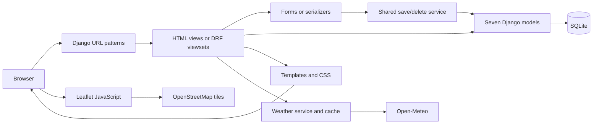
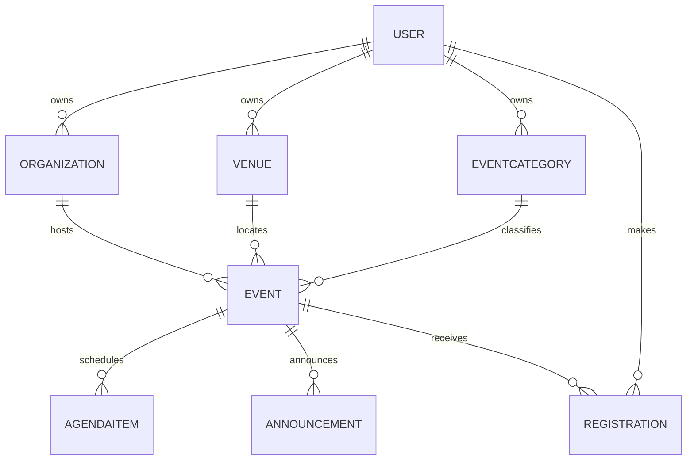

# CampusGather presentation and defense guide

Use this guide with the [complete walkthrough](CAMPUSGATHER_COMPLETE_WALKTHROUGH.md), [study lessons](CAMPUSGATHER_STUDENT_STUDY_GUIDE.md), and [one-page reference](CAMPUSGATHER_QUICK_REFERENCE.md). The implementation is in `C:\Users\brene\Desktop\CampusGather`. Current measured results belong in [IMPLEMENTATION_STATUS.md](../IMPLEMENTATION_STATUS.md); do not describe a planned check as a passed check.

## Prepare before the presentation

1. Start the existing project using the [README Windows commands](../README.md). Use the project's `.venv\Scripts\python.exe`. Confirm the local address and use the same host and port throughout.
2. Know your own passwords for `demo_organizer`, `demo_student`, and a separately created superuser. No administrator or universal password is seeded. Keep credentials and `.env` off the projector.
3. Use separate browser profiles or private windows for organizer, student, and administrator. Two ordinary tabs in one browser profile share a session; changing users in one changes the other.
4. Choose a new synthetic prefix, such as `Defense practice`, for everything you will create. Keep a note of the seven created IDs. Do not delete the existing sample events or real records. Before the timed talk, create a separate ordinary practice account through signup for the role-management demonstration; grant and then revoke only that account's organizer access.
5. Choose a future date two days from the demonstration in Philippine time, with an event from 09:00 to 11:00 and an agenda from 09:00 to 10:00. This keeps registration open and ordinarily puts weather within the supported date window. Recheck the date on presentation day.
6. Put the text below in a local note for quick typing. Open the organizer dashboard, the student's discovery page, administrator roles, `/api/`, and the source files you will explain. A live weather request can fail even when local tests pass; rehearse the explanation below.
7. Rehearse the sequence with a timer. It is a fast CRUD demonstration: show each saved detail rather than reading every field. Keep longer source explanations and Postman work for questions.

| Record | Demonstration values; all are synthetic |
|---|---|
| Organization | `Defense practice Society`; description `Student learning activities`; email `practice@example.test` |
| Venue | `Defense practice Hall`; address `Example campus, Puerto Princesa`; latitude `9.7392`, longitude `118.7353` |
| EventCategory | `Defense practice Workshop`; description `Beginner workshops` |
| Event | `Defense practice Python Workshop`; the three records above; description `A synthetic classroom demonstration`; future 09:00–11:00; initially Draft |
| AgendaItem | `Defense practice Opening`; same event; future 09:00–10:00 |
| Announcement | `Defense practice Welcome`; body `Please check the saved venue and schedule.` |
| Registration | Student registers for that published event; note `I will join the beginner exercises.` |

The actual seed names are `Demo: CampusGather Society`, `Demo: Innovation Hall`, `Demo: Campus Quadrangle`, `Demo: Workshop`, and `Demo: Community`. Seeding creates dates on first creation and preserves them on reruns. It is not a command for refreshing old dates or resetting accounts.

## A complete 14 minute 45 second demonstration script

The quoted paragraphs are intended to be spoken. The action column is what you do on screen. Timings include clicks and short pauses. If setup or login takes longer, shorten the source explanation; still complete the cleanup after the talk.

| Time | Action and speakable script |
|---|---|
| **0:00–0:45 — Introduce the project** | Show discovery. **Say:** “CampusGather is our campus event planner. Students can find activities, check their schedule and location, and manage their own registrations. Organizers maintain the events they own. Administrators grant organizer access and oversee records. The purpose is to put event information and participation in one place, so students do not have to depend on scattered announcements.” |
| **0:45–1:40 — Explain the architecture** | Show the diagram below, then `config/urls.py`, `events/views.py`, and `events/models.py` briefly. **Say:** “The browser sends a request to Django. A URL pattern selects a view, which reads database records and renders an HTML template. CSS styles the page; JavaScript handles the interactive map. Forms validate browser input. API clients use serializers instead of HTML forms. Both write paths call the same service, so they enforce the same business rules. SQLite stores our application data. Django requests weather from Open-Meteo on the server; the browser loads map tiles from OpenStreetMap through Leaflet.” |
| **1:40–2:25 — Organization CRUD: create, read, update** | As organizer, Organizer desk → Organizations → Add. Save the synthetic organization, read its detail, Edit, change the description, save. **Say:** “This is Create, Read, and Update for Organization. The server assigns my account as its owner. A student cannot create this record or give themselves organizer powers. We will demonstrate Delete after its dependent event is removed.” |
| **2:25–3:15 — Venue CRUD and map selection** | Venues → Add; enter the address, click the map or enter both coordinates; save. Read detail; edit the name to `Defense practice Hall A`; save. **Say:** “A venue stores an address and two geographic coordinates. Clicking the map fills the coordinate fields. Saving the form stores those numbers in SQLite. Leaflet is the map interface, and OpenStreetMap supplies the background tiles. The initial Philippines overview is not an automatically saved location.” |
| **3:15–3:45 — Category CRUD** | Categories → Add; save; read; edit its description and save. **Say:** “EventCategory labels events for discovery. This category, venue, and organization belong to the same organizer. That relationship is checked on the server, including API requests.” |
| **3:45–4:45 — Event CRUD and publishing** | Events → Add; select the new dependencies; enter future times; save Draft. Read its detail. Edit and publish. Open its public event page. **Say:** “An Event links to one organization, venue, and category. A new event must start as a draft. Updating it to Published makes it public and opens registration while its start time is still in the future. A published event can be cancelled; it cannot return to Draft. A cancelled event cannot reopen.” |
| **4:45–5:30 — Agenda CRUD** | Add agenda item for the new event; save and read; edit its title and save. **Say:** “AgendaItem stores one scheduled part of the event. Its end must follow its start, and its whole time window must fit inside the event. An existing agenda item cannot be moved to another event. Rescheduling the event is also rejected if that would leave an existing agenda outside the new times.” |
| **5:30–6:10 — Announcement CRUD** | Add announcement for the new event; read it; edit the body and save. **Say:** “Announcement stores an organizer message for this event. It appears on the event detail page. It has a server-generated creation time and stays with its original event.” |
| **6:10–7:45 — Student workflow and Registration CRUD** | Switch to the student window. Briefly show signup fields, then use the prepared student account. Search for the synthetic title, filter its category, open the event. Register; read the registration; edit its note; save; return to My registrations. **Say:** “Signup creates a normal student account using Django's user and password handling. Searching and filtering retrieve visible events. Registration is our seventh resource. The server takes the student identity from the signed-in user; the submitted form does not choose another student. I can read and edit my attendance note while registration is open. The event and student identities cannot change. One student can have only one registration per event.” |
| **7:45–8:30 — Back navigation and privacy** | Follow Back from a filtered event detail; show restored search/category context. Open My registrations and its detail; use Back. **Say:** “Back is a normal server-rendered link. The app carries a validated `return_to` destination and keeps useful search, category, and page values. If I open a page directly, it uses a sensible parent. It rejects external sites, unavailable private records, form actions, and self-links. Hiding a button is not our security boundary: views and write services still check access.” |
| **8:30–9:30 — Event map and weather** | Show the event pin, popup, coordinates, and weather panel. **Say:** “The pin uses this saved venue's latitude and longitude. The popup shows its name and address. For weather, Django converts the event time to the configured Asia/Manila date and requests daily minimum and maximum temperature, a condition code, and rain probability from Open-Meteo. This is a forecast for that date, not a measurement for the exact event hour. A valid result is cached for fifteen minutes. If rain probability is missing, we still display valid temperatures and the condition, and say rain probability is unavailable. The source and licence remain visible.” |
| **9:30–10:25 — Organizer roster and administrator** | Organizer window: View roster for the new event. Administrator window: `/accounts/roles/`; grant and revoke organizer access for the separate practice account. Briefly show `/manage/registrations/` and native `/admin/` Users. **Say:** “The organizer can read the roster for their own event, but cannot edit another student's note or cancel that student's registration. A superuser can manage all application records and grant or revoke the Organizers group. Django's staff flag alone is not our application administrator role. Native Django admin handles users and groups; the seven application models are read-only there. Domain writes go through our custom pages or API and their shared validation.” |
| **10:25–11:25 — REST API** | In the organizer session, open `/api/`, then `/api/events/` and the created event detail. Show JSON through the browsable API's format control or `?format=json`. If rehearsed, PATCH the new announcement's body using the browsable API's raw-data form and show HTTP 200. **Say:** “Our own REST API exposes the same seven resources. GET reads, POST creates, PUT supplies a full update, PATCH changes selected fields, and DELETE removes a record. JSON names fields and values so another program can use them. Serializers validate input and format output. This API uses session login and CSRF protection, not bearer tokens. A successful creation returns 201; a partial update returns 200. Draft visibility and registration privacy apply here as well.” |
| **11:25–13:50 — Finish Delete for all seven resources** | First, student cancels the new Registration through its confirmation page. Organizer deletes the new AgendaItem and Announcement individually. Then delete the Event, Venue, EventCategory, and Organization. Read each confirmation and success message. **Say:** “Deletion follows dependencies. Registration protects its event from deletion, so the student first cancels their own registration. We explicitly remove the agenda and announcement to demonstrate their Delete actions. Deleting an unregistered event would also cascade to those two child tables. Only after the event is gone can we remove its protected venue, category, and organization. This is why database relationships affect the order of CRUD operations. HTML deletion requires POST after confirmation; opening a link does not delete data.” |
| **13:50–14:45 — Testing, limitations, and close** | Show the current results table in `IMPLEMENTATION_STATUS.md`, then the source inventory below. **Say:** “We test login, roles, ownership, all seven CRUD resources, private registrations, validation, deletion, competing database writes, navigation, and weather parsing and cache behavior. Mocked weather tests check our code under controlled responses; a live request is a separate check. The current recorded results are shown here. SQLite and synchronous external requests suit this local classroom application, but production deployment and load testing require further work. Internet failures do not remove the event information or registration workflow. I used AI assistance in building and improving the project, and these are the parts I have studied and can trace in the source. I will distinguish what I understand from what I still need to study.” |

### If the weather is unavailable during the demonstration

Say the explanation that matches the actual displayed state:

- **Past:** “This event's Manila date has passed. This service provides future forecasts; it does not substitute today's weather.”
- **Out of range:** “CampusGather accepts today through fifteen days ahead. This date is beyond that window, so no request is made yet.”
- **Invalid location:** “The saved coordinates need correction by the organizer. The application does not invent a location.”
- **Temporary failure:** “This response did not supply a usable forecast, or the provider request failed. The weather panel explains that state, and the event and registration remain available. The recorded live check and mocked tests are separate evidence.”

Do not relabel a screenshot, mocked response, or earlier forecast as live data. On **13 November 2026**, direct live checks of saved events 1 and 2 returned HTTP 200 with data accepted by the old parser; saved event 2 was the 16 November `Demo: Green Campus Meetup`. Those checks did **not** reproduce the historical screenshot's failure. A separate confirmed defect was that optional missing rain caused the old parser to reject an otherwise usable forecast; it is now handled without fabricating a rain percentage. The final check record is [IMPLEMENTATION_STATUS.md](../IMPLEMENTATION_STATUS.md). Event dates were not changed to produce that result.

## All seven CRUD resources at a glance

`<id>` means the ID returned for your new record. It is not necessarily 1. The six organizer resources use the same generic views and different model/form specifications. Registration has dedicated views.

| Model | Create / Read / Update / Delete in the website | API collection |
|---|---|---|
| Organization | `/manage/organizations/add/` → saved detail → `edit/` → `delete/` after dependent events | `/api/organizations/` |
| Venue | `/manage/venues/add/` → saved detail → `edit/` → `delete/` after dependent events | `/api/venues/` |
| EventCategory | `/manage/categories/add/` → saved detail → `edit/` → `delete/` after dependent events | `/api/categories/` |
| Event | `/manage/events/add/` → saved detail/public `/events/<id>/` when visible → management `edit/` → `delete/` after registrations | `/api/events/` |
| AgendaItem | `/manage/agenda-items/add/` → saved detail/event schedule → `edit/` → `delete/` | `/api/agenda-items/` |
| Registration | `/events/<event-id>/register/` → `/registrations/<id>/` → `edit/` → `cancel/` | `/api/registrations/` |
| Announcement | `/manage/announcements/add/` → saved detail/event announcements → `edit/` → `delete/` | `/api/announcements/` |

For the generic management resources, a saved detail is `/manage/<resource>/<id>/`; append `edit/` or `delete/`. Admin registration paths begin `/manage/registrations/`. Read access is role-dependent. An organizer does not receive general write access to student registrations.

For an explicit seven-resource Delete demonstration, use **Registration → AgendaItem → Announcement → Event → Venue → EventCategory → Organization**. The last three may be removed in any order once no event references them. Deleting Event alone cascades AgendaItem and Announcement, but that would not demonstrate their individual Delete buttons. Never use another person's registration for cleanup; its student or an administrator must remove it.

## Architecture, database, and technology explanation



Say: “Django connects the request to Python code. The view chooses the records and response. A model defines stored data; a form or serializer checks submitted data. The service performs an authorized, validated transaction. HTML is the human interface, and JSON is the program interface. Weather requests happen on the Django server, while map tiles load in the browser.”

The stack is Python, Django, Django REST Framework, SQLite, HTML, CSS, JavaScript, Leaflet, OpenStreetMap tiles, `requests`, and Open-Meteo. `python-dotenv` loads local configuration. The pinned dependency versions are in `requirements.txt`. Node is not an application runtime requirement.



Say: “Every application record has an automatically generated ID. A foreign key stores the ID of another record. One organization can host many events; one event has many agenda items, announcements, and registrations. Registration connects a user and event and stores its own note and creation time. It represents a many-to-many participation relationship through a real model; there is no declared `ManyToManyField` for this in our code. No application one-to-one relationship is defined. User is Django's built-in account model, outside our seven principal application models.”

## API demonstration notes

Start with GET `/api/`. Follow resource links; do not guess IDs. Collections use pagination with `count`, `next`, `previous`, and `results`, normally 20 records per page. The HTML discovery page implements search/category filters; the API does not implement those filters.

This is a **representative write body**, not evidence that a request was executed:

```http
POST /api/organizations/
Content-Type: application/json
X-CSRFToken: <current token from your local authenticated session>
```

```json
{"name":"Defense practice Society","description":"Synthetic example","contact_email":"practice@example.test"}
```

A successful organizer creation returns **201** with fields `id`, `name`, `description`, and `contact_email` for that owner. The optional `owner` input is write-only and does not appear in JSON output. Omit server-generated IDs from write bodies. For an event use saved `organization`, `venue`, and `category` IDs, valid ISO timestamps, and initial `status: "draft"`. Publish using `PATCH /api/events/<id>/` with `{"status":"published"}`. Registration creation accepts `event` and `attendance_note`; the server assigns `student` and `created_at`.

For Postman, use the full instructions in [docs/api.md](api.md): GET the login page, POST its form with CSRF, retain session cookies, then use the **new** CSRF token after login in `X-CSRFToken` for unsafe API methods. Keep host and port consistent. Do not disable CSRF or project real tokens. The browsable API login and forms handle this browser flow more conveniently.

## Likely professor questions with accurate answers

1. **What problem does CampusGather solve?** It puts campus event information, schedules, locations, announcements, and registrations in one application, with separate student, organizer, and administrator capabilities.
2. **Who are the users?** Visitors can read public events, signed-in students manage their own registrations, organizers manage their own event resources, and superusers administer the application.
3. **Why use Python?** Python is the language used for our Django application logic. We use it to define models, views, validation, permissions, and the weather client.
4. **Why choose Django?** The project needs accounts, forms, database records, routing, templates, migrations, and security protections. Django provides those components in one framework, which keeps our application consistent.
5. **What does Django REST Framework add?** It supplies model serializers, viewsets, API permissions, pagination, routing, and a browsable interface for our seven resources.
6. **What is the difference between a model, view, and template?** In this project a model defines stored event data, a view handles a request, and a template produces the HTML the browser displays.
7. **What happens when I open an event?** `events/urls.py` matches `/events/<id>/` to `event_detail`; the view checks visibility, fetches related data, gets weather, and renders `templates/events/event_detail.html`.
8. **What are the seven models?** Organization, Venue, EventCategory, Event, AgendaItem, Registration, and Announcement. Django's built-in user and session tables are separate infrastructure.
9. **What is a primary key?** It uniquely identifies a row. Our models receive an automatic `BigAutoField` ID through `DEFAULT_AUTO_FIELD` in `config/settings.py`.
10. **What is a foreign key?** It links one record to another. `Event.venue` links an event to a saved Venue; the database stores the referenced venue ID.
11. **What is a one-to-many relationship here?** One Event can have many AgendaItems. Every AgendaItem belongs to one Event through its `event` foreign key.
12. **Is there a many-to-many relationship?** Logically, users can register for many events and events can have many users. Registration is the connecting model with note/time data. We do not declare a direct `ManyToManyField`.
13. **Do you have a one-to-one profile model?** No. `accounts/models.py` does not add one. Accounts use Django's configured user model and the Organizers group.
14. **Why SQLite?** It is the configured local database and needs no separate database server. It suits this classroom setup. We have not demonstrated production scale or high write throughput.
15. **What is CRUD?** Create adds a record, Read retrieves it, Update changes it, and Delete removes it. All seven resources expose authorized CRUD, with relationship and permission restrictions.
16. **Why only six organizer resource cards?** Registration has its own student and administrator workflows. The generic `RESOURCES` dictionary contains the other six models.
17. **What is authentication?** It establishes who is signed in. Django checks the user's password and maintains a session; our login/logout use Django's authentication views.
18. **What is authorization?** It decides which actions that user may perform. `events/permissions.py`, scoped querysets, API permissions, and services enforce those decisions.
19. **How does signup prevent self-promotion?** `SignUpForm` accepts ordinary profile fields and inherited password fields. It does not accept groups, `is_staff`, or `is_superuser` as signup fields.
20. **Is an organizer the same as a staff user?** No. `is_organizer` checks the Organizers group or superuser status. `is_staff` controls native admin entry, subject to native Django permissions.
21. **Who is the application administrator?** An authenticated superuser. The app's `is_admin` checks `is_superuser`, not just `is_staff`.
22. **Where is event ownership stored?** The Event refers to an Organization, and the Organization has an owner. `can_manage` follows that relationship; Event has no separate owner field.
23. **Can an organizer change another organizer's event by editing the URL?** The HTML/API querysets exclude unauthorized write targets, and the write service rechecks ownership. Changing the address alone does not grant access.
24. **Can an organizer cancel an attendee's registration?** Not unless it is their own registration or they are a superuser. An organizer can read their own event's roster. Read access does not grant edit/delete access.
25. **Can an administrator register a chosen student through this API?** No. Registration creation always assigns the acting user. The serializer's `student` is read-only; the service sets the student.
26. **Can a student register twice?** No. Validation rejects duplicates, and a database unique constraint covers `(event, student)` even if competing requests try to insert together.
27. **When does registration close?** `registration_open` requires Published status and a start time later than now. Note edits also close then, including for administrators. Authorized cancellation remains possible.
28. **Does cancelling a registration cancel the event?** No. The registration row is deleted. Event cancellation changes the Event status and retains existing registrations.
29. **Why must a new event be a draft?** `Event.clean` and input choices enforce a draft-first workflow. Publishing is a later validated update; cancelled events cannot reopen.
30. **How are dates validated?** End must be after start. Agenda times must fit inside the event. Rescheduling an event cannot strand existing agenda items outside its new time window.
31. **Does `save()` automatically call all model validation?** No. Our `save_record` explicitly calls `obj.full_clean()` before `obj.save()`. Direct ORM writes can bypass those service checks, so ordinary domain writes use the service.
32. **Why share a service between HTML and API?** Forms and serializers have different input jobs, but both must apply the same ownership, identity, timing, and database rules. `save_record` and `delete_record` provide that common write path.
33. **What is a transaction?** It groups database work so it completes together or rolls back on failure. Our services use `transaction.atomic()` for short writes.
34. **Does SQLite give you row locks with `select_for_update`?** No. Settings use SQLite `transaction_mode: "IMMEDIATE"` and a ten-second database timeout to serialize short writes. The service gives a retry message if a lock wait fails; it is not unlimited concurrency.
35. **Why can deleting an event fail?** Registration's event foreign key uses PROTECT. Registrations must be removed by authorized users first. Event's organization, venue, and category are also protected from deletion while referenced.
36. **What is CASCADE?** Deleting the parent automatically removes those children. AgendaItem and Announcement cascade when an Event is deleted; Registration does not.
37. **What is an API?** It is a defined interface another program can call. Our `/api/` returns structured resource data and accepts authorized changes without needing to read HTML pages.
38. **What makes the API REST-style?** Resource URLs identify records, and HTTP methods express operations: GET, POST, PUT, PATCH, and DELETE. Our router builds collection and detail endpoints for seven resources.
39. **What is JSON?** A text format containing objects, arrays, strings, numbers, booleans, and null. Our API uses keys such as `title`, `event`, and `attendance_note` to describe data.
40. **What does a serializer do?** It converts model values into API output and validates submitted fields. Our `ResourceSerializer` also rejects unknown fields and conflicting read-only identities, then calls the shared service.
41. **PUT or PATCH?** PUT requires all required writable fields for a full update. PATCH accepts selected fields. The final merged object still receives full model validation.
42. **What do common status codes mean?** 200 is a successful read/update, 201 creation, 204 deletion, 400 invalid data, 403 denied access or CSRF failure, 404 absent/hidden row, 409 protected deletion, and 503 temporary database contention in our API.
43. **Does the API use token authentication?** No. It uses Django sessions through DRF SessionAuthentication. Authenticated POST/PUT/PATCH/DELETE requests need a valid CSRF token as well as the session cookie.
44. **Why does the API hide some fields?** Organization contact email is returned only to its owner/admin. `owner` is write-only. Registration querysets limit which rows a caller can see. These are deliberate privacy boundaries.
45. **What is Open-Meteo?** It is the external forecast service called by `events/weather.py` at `https://api.open-meteo.com/v1/forecast`. CampusGather's own REST API is separate from that provider API.
46. **Which date and location are requested?** The event's start time converted to `settings.TIME_ZONE`, currently Asia/Manila, and the saved venue latitude/longitude. Both `start_date` and `end_date` use that same date.
47. **Why can a future event lack weather?** This integration supports offsets zero through fifteen days. A farther future date is outside the window and shows a not-yet-available message without sending HTTP.
48. **Was the historical screenshot's root cause proven?** No. Later live requests for saved events 1 and 2 succeeded and the old parser accepted them. A confirmed optional-rain parser bug was fixed, but that is not proof it caused that earlier screenshot.
49. **What exactly changed in the rain parser?** Missing or null optional rain can now leave `rain_probability` as None while required date, temperatures, and condition remain valid. Supplied malformed/out-of-range rain still rejects the payload. Missing rain never becomes zero percent.
50. **What is caching here?** A successful parsed forecast is reused for 900 seconds. The key hashes the request parameters, including coordinates, date, fields, and timezone, under the `event-weather:v2:` prefix. Failures are not cached.
51. **Why check the date before reading the cache?** An event can become past while a previous success is still cached. The date checks prevent reusing a now-ineligible future forecast.
52. **What happens on a weather timeout?** `requests.get` has connect/read timeouts `(2, 3)`. The service returns a temporary-unavailable state and logs a reason. Those are timeout settings, not a promise of an exact five-second total wall time.
53. **What is Leaflet?** The JavaScript library that displays the map, markers, zoom controls, and popup. It does not itself supply our weather or map tiles.
54. **What is OpenStreetMap?** The map data source credited in the tile layer. Our browser requests background tile images from `tile.openstreetmap.org`.
55. **What are latitude and longitude?** Latitude measures north/south position from −90 to 90; longitude east/west from −180 to 180. Venue validators reject nonfinite and out-of-range numbers.
56. **How does the map avoid executing an organizer's popup text?** The script creates DOM elements and assigns `textContent` for name/address. The template transfers map data with Django's `json_script`, rather than inserting untrusted HTML into a JavaScript string.
57. **What happens without map internet access?** Scripts show fallback information. The address and coordinates remain on the page, and the venue form still accepts typed coordinates. Map failure does not delete the saved location.
58. **How do Back links prevent unsafe redirects?** `safe_destination` checks host/scheme, path shape, resolved route, user access, and permitted list query values. It rejects unsafe destinations and uses a named parent. It does not rely on browser history.
59. **Why not trust an arbitrary same-site URL?** It could be a logout/form action, self-link, nonexistent record, or page the current user cannot read. Route and object-access checks narrow the destination beyond a host check.
60. **What security protections are present?** Django password hashing, password validators, sessions, CSRF middleware, template escaping, ORM query construction, ownership checks, database constraints, safe navigation, and safe popup text. This does not establish that every possible attack has been audited.
61. **What do automated tests prove?** They check selected expected behaviors with controlled inputs and isolated data. Account/API/website/rule/concurrency/seed/weather/navigation tests cover important flows. They do not prove every browser, live provider response, or production load.
62. **Why mock weather HTTP?** Controlled responses make timeouts, bad JSON, missing rain, date matching, and cache behavior repeatable without depending on internet access. A mocked pass is different from a successful live forecast.
63. **How many tests passed?** Read the latest dated table in `IMPLEMENTATION_STATUS.md`. The original baseline was 65 passing tests; this delivery adds focused regression checks. Use the final measured count rather than memorizing an outdated number.
64. **Can rerunning `seed_demo` destroy existing schedules?** It reuses matching examples and preserves existing users, roles, passwords, dates, edits, and cancelled registrations. It does not refresh an old demonstration event's date or enroll existing students automatically.
65. **What is still limited?** This is a local SQLite application with synchronous external weather and browser-loaded map resources. Forecasts can change; network services can fail. Production deployment, scale testing, and the remaining device/accessibility checks must follow the recorded evidence.
66. **Did you personally write every line without assistance?** A truthful answer is: “I used AI assistance. I am studying the generated and revised code, and I can explain these request flows and checks. I will say when a part needs further study.” Do not claim authorship or understanding you have not earned.

## Source files to open if challenged

| Question | Actual source |
|---|---|
| Seven models, field types, relationship and schedule rules | [`events/models.py`](../events/models.py) |
| Role checks, visible drafts, ownership | [`events/permissions.py`](../events/permissions.py) |
| Shared authorized transactional writes and protected deletion | [`events/services.py`](../events/services.py) |
| Browser CRUD, registration, search, roster | [`events/views.py`](../events/views.py), [`events/forms.py`](../events/forms.py), [`events/urls.py`](../events/urls.py) |
| Signup, login/logout, organizer assignment | [`accounts/forms.py`](../accounts/forms.py), [`accounts/views.py`](../accounts/views.py), [`accounts/urls.py`](../accounts/urls.py) |
| API fields, viewsets, access, endpoints | [`events/api/serializers.py`](../events/api/serializers.py), [`events/api/views.py`](../events/api/views.py), [`events/api/permissions.py`](../events/api/permissions.py), [`events/api/urls.py`](../events/api/urls.py) |
| Back safety, parent selection, context | [`events/navigation.py`](../events/navigation.py), [`events/context_processors.py`](../events/context_processors.py) |
| Forecast parameters, validation, cache | [`events/weather.py`](../events/weather.py) |
| Map data and markers | [`templates/events/event_detail.html`](../templates/events/event_detail.html), [`static/js/event-map.js`](../static/js/event-map.js), [`static/js/venue-map.js`](../static/js/venue-map.js) |
| Setup, database/timezone/security settings, tests | [`README.md`](../README.md), [`config/settings.py`](../config/settings.py), [`events/tests`](../events/tests), [`accounts/tests.py`](../accounts/tests.py) |

Before defense, practice explaining one complete registration request without reading: URL → view → form → `save_record` → permission/model validation → database → redirect/detail. Then trace weather and map separately. That is more useful than memorizing every answer word for word.
