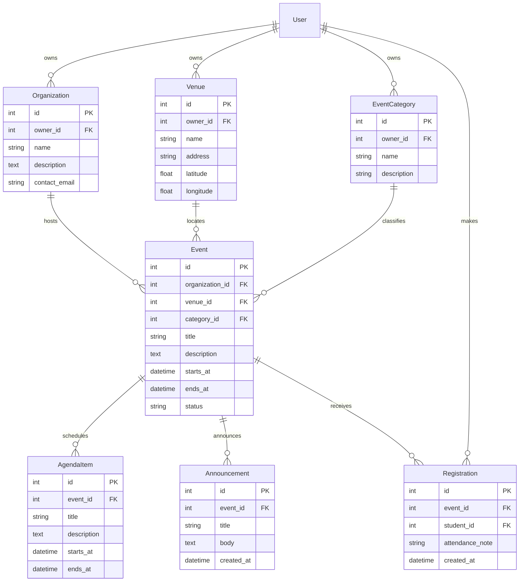

# Database design

CampusGather has seven application tables. Django supplies `User` and its authentication tables separately. Every application model has Django's integer `id` primary key. Only Registration and Announcement have a `created_at` timestamp in the current code.

| Model | Required business fields | Optional fields |
|---|---|---|
| Organization | name (120), owner | description (3000), contact_email |
| Venue | name (120), address (250), latitude, longitude, owner | None |
| EventCategory | name (80), owner | description (250) |
| Event | organization, venue, category, title (160), description (6000), starts_at, ends_at | status defaults to `draft` |
| AgendaItem | event, title (160), starts_at, ends_at | description (2000) |
| Registration | event, student | attendance_note (300) |
| Announcement | event, title (160), body (3000) | None |

Numbers in parentheses are maximum text lengths. Dates are timezone-aware; pages use Asia/Manila. Coordinates are floating-point numbers with finite/range validation. The current schema does not enforce unique catalog names; the seed uses deterministic owner-and-name lookups to reuse its examples. Registration has a database uniqueness constraint on `(event, student)`.

An event's organization, venue, and category must share the same owner. Owner fields and an existing event's organization are immutable in application writes. AgendaItem/Announcement cannot change their event. Registration cannot change its event or student. Event end must follow start, and agenda times must remain inside the event window. Both models also have database constraints requiring end after start. Venue range constraints complement application validation of finite coordinates.

## Deletion rules

| Deleting this record | Result |
|---|---|
| User referenced as owner or registered student | Protected; referenced data must be handled first |
| Organization, Venue, or EventCategory referenced by an Event | Protected |
| Event with one or more registrations | Protected; no agenda or announcements are deleted |
| Event without registrations | Event deleted; its AgendaItems and Announcements cascade |
| AgendaItem, Announcement, or Registration | Direct deletion when the caller has permission |

`PROTECT` prevents removing a referenced row. `CASCADE` removes dependent rows along with their parent. The shared delete service turns protected deletion into a readable conflict response instead of a raw database exception. Cancellation changes an event's status and preserves all related records; it is different from deletion.

See [models.py](../events/models.py), [the initial migration](../events/migrations/0001_initial.py), and [services.py](../events/services.py) for the executable definitions.
