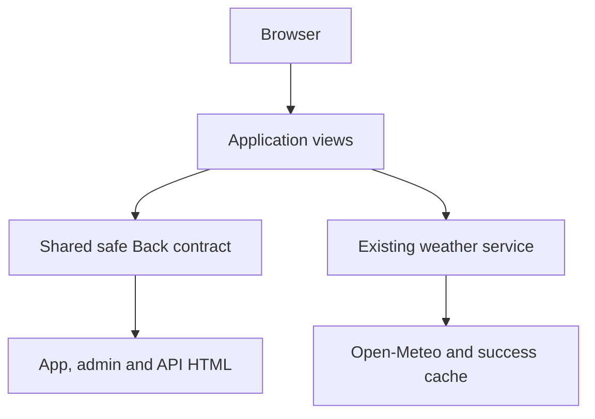
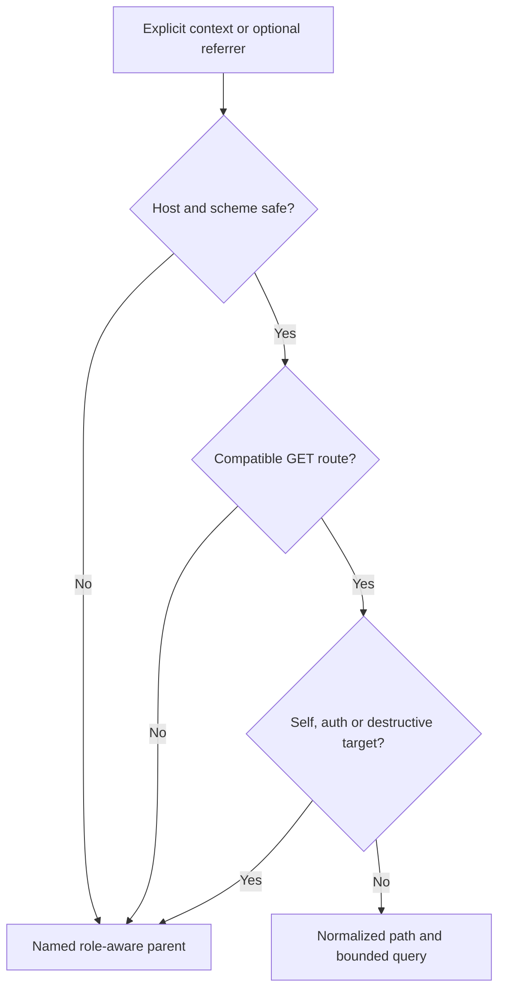
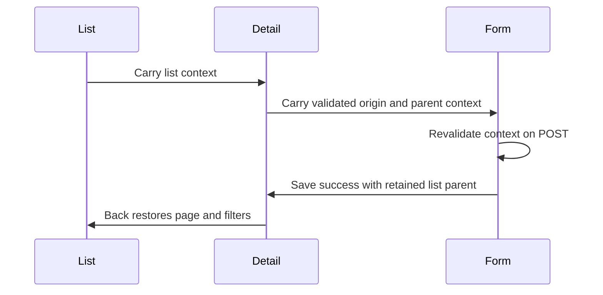
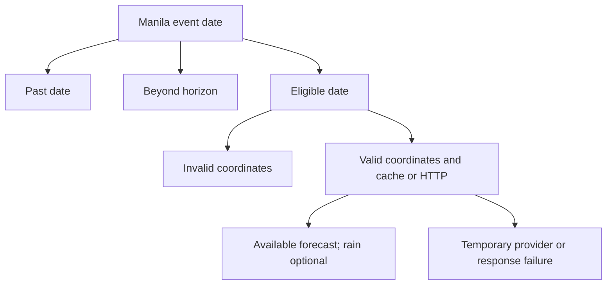
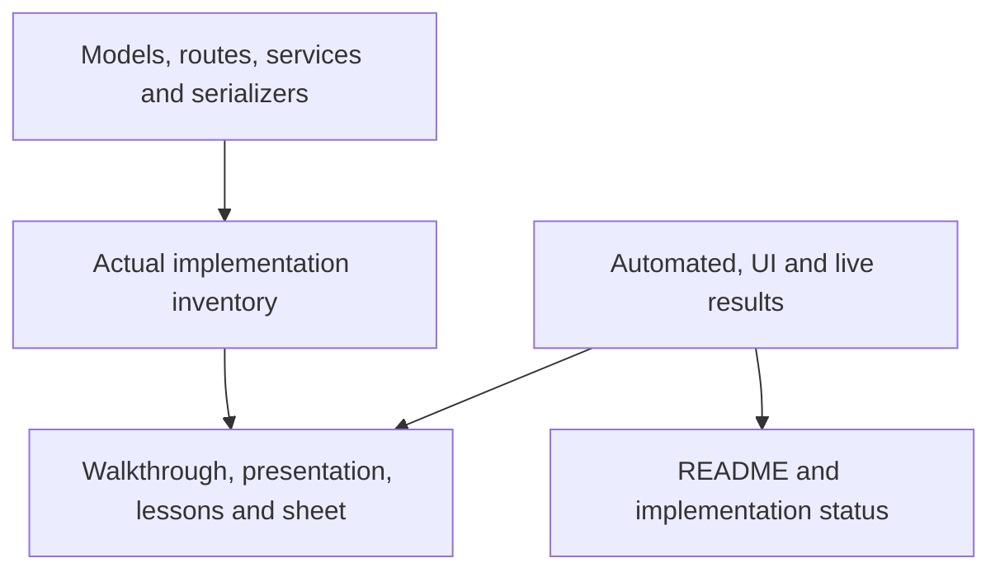

# CampusGather Navigation, Weather and Teaching - Plan

## Goal Capsule

- **Objective:** Students can navigate CampusGather reliably, demonstrate its real event weather, and explain and defend the working application from accurate teaching material.
- **Means:** Extend the existing Django navigation, Open-Meteo service and teaching documents under KTD1-KTD5.
- **Authority:** The user's seven-task improvement request governs product scope; R1-R12 carry its requirements. Repository evidence and official provider/framework documentation govern implementation facts.
- **Execution profile:** Standard depth; one coherent local delivery in the existing CampusGather repository. No GitHub publication or hosted deployment is requested.
- **Completion owner:** The implementing workflow completes U1-U4, verification and the final evidence report.
- **Stop conditions:** Preserve R1 throughout. Continue other work if a live external check is unavailable and report its exact limitation under R12.

---

## Product Contract

### Summary

Add consistent safe Back navigation, diagnose and improve the existing weather integration, verify the application, and create complete beginner-friendly guides grounded in the final code and actual results.

### Problem Frame

Several useful pages have no obvious return control, and event-card links discard discovery filters. A generic weather message hides whether the problem is a request, response or location issue. The student also needs to understand the actual source and permissions well enough to demonstrate the application and answer technical questions.

### Requirements

**Preservation and review**

- R1. Preserve the working application, its seven principal models and relationships, migrations, database, existing tests and user data; reuse established dependencies and shared validation/authorization services.
- R2. Review the complete student, organizer, administrator and seven-resource HTML/API workflows, fixing reproducible local defects at the narrowest responsible layer without adding major features.

**Navigation**

- R3. Important student, organizer, administrator, account, form, detail and management pages provide one near-top arrow-left and visible `Back` link with a useful parent; native admin and browsable API receive equivalent HTML navigation where applicable.
- R4. A valid same-site prior destination preserves useful search, filter and page context across links, validation errors and successful edits, while direct entry has a deterministic parent and unsafe destinations or loops fall back safely.

**Weather and demonstration**

- R5. Diagnose the screenshot's generic weather failure using the actual implementation, saved event/venue/date and available runtime/live HTTP evidence; report uncertainty rather than inferring a cause from the screenshot.
- R6. The existing integration uses saved coordinates and the correct configured Philippine event date, validated current Open-Meteo parameters, real condition/date/minimum/maximum temperatures, optional rain probability, an appropriate accessible icon, attribution and suitable caching.
- R7. Distinguish available, past date, beyond-horizon date, invalid coordinates and temporary provider/response failure, keeping event details, maps and registration usable in every weather state.
- R8. Demonstrate at least one saved upcoming event within the current forecast horizon; preserve real and existing user-edited schedules, extending synthetic demo maintenance only if necessary.

**Teaching deliverables and evidence**

- R9. Create `docs/CAMPUSGATHER_COMPLETE_WALKTHROUGH.md` with all requested A-M sections, actual fields/classes/functions/routes, Mermaid architecture and ER diagrams, all seven CRUD resources, eleven traced workflows, setup and current testing/security explanations.
- R10. Create `docs/CAMPUSGATHER_PRESENTATION_GUIDE.md` with a complete script, 10-15 minute role/CRUD/API/map/weather demonstration and at least 40 accurate beginner-friendly questions and answers.
- R11. Create `docs/CAMPUSGATHER_STUDENT_STUDY_GUIDE.md` with lessons that each include plain explanation, actual code, analogy, terms, three answered questions, one exercise and a professor question; add a one-page quick reference.
- R12. Run the requested automated/runtime/UI checks and update `README.md` and `IMPLEMENTATION_STATUS.md`, separating passed/failed tests, live provider checks, static review and remaining manual checks without fabricated outcomes.

### Acceptance Examples

- AE1. **Covers R3, R4:** A student opens a filtered, paginated discovery result, views its event and uses Back; the same `q`, `category` and `page` are restored. A direct event URL returns to discovery.
- AE2. **Covers R4:** An organizer opens a resource from page 2, edits it and saves; the resulting detail retains Back to page 2. A delete confirmation can return to the detail, while successful deletion returns to a surviving list.
- AE3. **Covers R4:** External, malformed, self, logout, mutation/confirmation and unauthorized-role return destinations are ignored; the rendered link uses a known safe parent.
- AE4. **Covers R6, R7:** An in-range response with valid date, temperatures and WMO condition but unavailable rain still displays its real forecast and explains rain unavailability.
- AE5. **Covers R7:** Manila offsets -1, 0, 15 and 16 produce past, eligible, eligible and not-yet-available states respectively; provider failure never changes event/registration behavior.
- AE6. **Covers R5, R8, R12:** A currently eligible saved demo event is checked against the real provider when possible, with the exact target date and outcome recorded separately from mocked tests.

### Scope Boundaries

R1 excludes rebuilding the app, schema churn, database resets, deleted tests and moving real event schedules. Existing native Django admin domain models remain read-only; user/group administration stays native, and domain writes stay in custom HTML/API services.

No new weather provider, persistent weather model, queue, JavaScript navigation framework, token/OAuth authentication or deployment is needed. Automatic provider retries inside page rendering are considered and not built: the existing bounded request and retry-on-later-visit behavior keep the flow understandable and avoid compounding outages.

### Sources

The user's request Tasks 1-7 and implementation rules are the product source. Existing `README.md`, `IMPLEMENTATION_STATUS.md` and `docs/` are implementation references, not fresh verification evidence.

---

## Planning Contract

### Existing Evidence

- `templates/base.html`, shared includes and `static/css/site.css` provide a common app shell. Native admin and DRF have independent template hierarchies. `accounts/views.py::signup` already uses Django's safe URL utility for authentication continuation.
- `events/views.py` separates six generic organizer resources from student/admin Registration CRUD. `events/services.py::save_record/delete_record` centralizes authorized transactional writes and `full_clean`; ordinary ORM `save` does not automatically provide those guarantees.
- `events/weather.py::forecast_for_event` already uses saved coordinates, explicit Manila dates, offsets 0-15, exact single-day parameters, a parameter-hash key, tuple timeouts `(2, 3)` and 900-second successful-result caching. Its parser currently requires non-null rain and combines network/HTTP/JSON/payload failure under one generic message.
- Read-only saved-data inspection on 13 November found the five existing fixtures intact. Published `Demo: Green Campus Meetup` starts 16 November 2026 at 14:26 Manila and is already a suitable upcoming demonstration candidate; both saved venues have valid Palawan coordinates. This does not prove a successful live forecast.
- `IMPLEMENTATION_STATUS.md` records 65 passing tests on 11 November 2026. No tests/application/live forecast were executed by this planning run; establish the current baseline during U4's opening verification.

### Key Technical Decisions

- KTD1. **One server-side Back contract.** Use a small shared navigation helper/context layer, reusable include and route-parent mapping, with separate minimal admin/DRF template overrides. Reuse normal escaped anchors and existing styles rather than browser history or duplicated per-template logic. This satisfies R3-R4 while preserving existing authorization and JSON behavior.
- KTD2. **Validate and carry a bounded destination.** Prefer explicit `return_to`, validate against Django's current-host/HTTPS utility, normalize to a local path/query, resolve compatible named GET routes and reject current/self, unknown, auth/logout, destructive/confirmation and cross-role targets. Revalidate POST values; retain only useful list context and strip nested return parameters. Referrer is optional evidence subject to the same policy, never a trusted destination. `next` remains authentication continuation, distinct from Back. [Django 5.2 authentication source](https://raw.githubusercontent.com/django/django/stable/5.2.x/django/contrib/auth/views.py), [URL validation source](https://raw.githubusercontent.com/django/django/stable/5.2.x/django/utils/http.py).
- KTD3. **Extend the existing weather result.** Retain `available` compatibility and add stable state/reason and icon data, with essential date/condition/temperature validation separated from optional rain. Validate coordinates before network/cache; never substitute coordinates or zero rain. Keep parameter-derived successful caching, versioning its prefix if needed for the changed result shape. Separate diagnostic reason categories without recording private event titles or user data. [Open-Meteo forecast reference](https://open-meteo.com/en/docs) confirms current field names, single-day dates, timezone and horizon; it does not establish this screenshot's cause.
- KTD4. **Evidence before timeout or demo changes.** Capture saved-data/target-date/request status/elapsed time/payload validation evidence before changing request timeouts or claiming R5's cause. Preserve current demo schedules while the eligible fixture exists. If execution-day inspection finds none, create a clearly labelled separate synthetic weather example rather than refreshing uncertain matching rows; ordinary seed reruns retain their existing preservation contract.
- KTD5. **Teach the final implementation.** Build guides from a source inventory and the final behavior, then insert measured verification results after U4. Explain actual service validation, superuser versus staff, six organizer resources plus Registration, and the logical student-event junction without inventing a `ManyToManyField` or user-profile model. Link existing short docs to the expanded guides where useful.

All directives were checked against existing architecture: preserving seven models, the provider and the service layer is workable. No competing structural mechanism remains that needs a bake-off.

### High-Level Technical Design

Component boundary for KTD1 and KTD3:

Back destination decisions under KTD2:

Form protocol preserving AE2:

Weather result states under R7:

Evidence-to-documentation data flow under KTD5:

### Assumptions

- A1. The quick-reference destination is `docs/CAMPUSGATHER_QUICK_REFERENCE.md`; the user requested the sheet without naming its file.
- A2. Discovery is the natural app root and needs no self-referential Back button; dashboards and other root surfaces have a useful app parent.
- A3. Exact helper names, icon representation and diagnostic formatting can follow the smallest existing patterns during implementation; no new dependency is required.

### System-Wide Impact and Risks

Shared navigation touches app, authentication, native admin and browsable API HTML; retain CSRF, session/logout semantics, breadcrumbs, popup behavior and view permissions. Navigation chooses destinations and must not reveal other users' object existence.

Weather is synchronous and external. A network failure or limited forecast field can remain possible after local fixes; show the appropriate state and document live limitations. Official free-service terms and attribution apply: preserve adjacent [Open-Meteo](https://open-meteo.com/) and [CC BY 4.0](https://creativecommons.org/licenses/by/4.0/) links, and indicate transformations where appropriate. [Provider licence](https://open-meteo.com/en/licence), [terms](https://open-meteo.com/en/terms).

### Deferred to Implementation

The historical screenshot cause, current cache state, actual live response and optimal timeout adjustment remain execution questions under KTD4. Native browser/admin/DRF rendering and complete current test results likewise require execution. None blocks starting the authorized implementation.

---

## Implementation Units

### U1. Consistent safe Back navigation

- **Goal:** Deliver R3-R4 and AE1-AE3 across the important HTML surfaces.
- **Dependencies:** None; agree the shared context contract before assigning template edits.
- **Files:** Add `events/navigation.py`, `events/tests/test_navigation.py`, a shared navigation include, minimal `templates/admin/base_site.html` and `templates/rest_framework/api.html` overrides. Modify `events/context_processors.py`, `events/views.py`, `accounts/views.py`, `templates/base.html`, relevant `templates/events/`, `templates/accounts/`, `templates/registration/` and error templates, and `static/css/site.css`; update `config/settings.py` only if the existing processor cannot supply the context.
- **Approach:**
  1. Implement KTD1-KTD2 and a route matrix covering event discovery/detail/register/roster, dashboard, all six resource list/create/detail/update/delete pages, student/admin Registration list/detail/edit/cancel/delete, signup/login/roles, errors, native admin and API root/list/detail/auth HTML.
  2. Carry list context from event cards and resource/registration lists into detail/actions, including event-parent agenda/announcement creation. Preserve the surviving parent through invalid POST and successful save/delete.
  3. Replace duplicated near-top links with the common control, retain structural breadcrumbs, and keep arrow decoration hidden from assistive technology while visible `Back` text and focus remain clear.
- **Patterns:** Existing signup URL validation, `templates/base.html`, pagination include and current button/back-link CSS. Native overrides extend blocks and retain parent content, per [Django admin docs](https://docs.djangoproject.com/en/5.2/ref/contrib/admin/#overriding-admin-templates) and [DRF browser docs](https://www.django-rest-framework.org/topics/browsable-api/).
- **Test seam:** `test_navigation.py` checks chosen destinations and emitted HTML across views; actual keyboard, visual and network behavior requires U4 browser proof.
- **Test scenarios:**
  1. Covers AE1: encoded search/category/page survive discovery-detail-Back; direct detail entry has a live discovery fallback.
  2. Covers AE2: list-detail-edit-save-detail retains the original list page; invalid form POST retains the same validated context.
  3. Covers AE3: external/protocol-relative/backslash/unsafe-scheme/control-character/malformed/unknown/self/auth/destructive and cross-role candidates fall back; HTTPS never permits downgrade.
  4. Delete confirmation Back points to a live detail; successful deletion goes to the surviving list. Protected-delete failure retains a usable parent.
  5. Student, organizer and superuser direct-entry matrices select their proper parents, without treating staff alone as application admin.
  6. Repeated list-detail round trips do not bounce or accumulate nested context; admin/API breadcrumbs and auth forms still work, and API JSON remains unchanged.
- **Verification:** Important page families render exactly one appropriate near-top Back control and pass the route/context tests plus U4 keyboard/mobile checks.

### U2. Diagnose and improve the existing forecast

- **Goal:** Deliver R5-R8 and AE4-AE6 without disrupting event details or saved data.
- **Dependencies:** Coordinate the `event_detail.html` weather block with U1's single template owner; weather service implementation can proceed independently.
- **Files:** `events/weather.py`, `events/tests/test_weather.py`, `events/tests/test_website.py`, `templates/events/event_detail.html`; `events/management/commands/seed_demo.py` and `events/tests/test_seed.py` only if R8 genuinely requires maintenance.
- **Execution note:** Reproduce the current saved-event request and characterize the failure category before changing its handling; regression tests distinguish mandatory payload fields from optional rain.
- **Approach:**
  1. Record the actual saved target's Manila date, coordinate validity, request parameters, provider HTTP/JSON outcome and parser result under KTD4, without printing secrets or inventing historical certainty.
  2. Implement KTD3, explicit R7 states and a condition-to-icon presentation contract; keep forecast date and fetch time distinct. Give missing rain clear text and maintain attribution even in unavailable states.
  3. Recheck the existing 16 November demo candidate against execution-day eligibility. Follow KTD4 only if no usable candidate remains, preserving normal seed behavior and explaining any new synthetic record.
- **Patterns:** Existing `_finite_number`, matched daily-date parsing, parameter-signature cache, frozen-clock/mocked HTTP tests and transactional seed preservation tests.
- **Test seam:** Existing weather unit tests prove request/parse/cache decisions under controlled inputs; rendered website tests prove graceful integration, while neither proves a current live provider result.
- **Test scenarios:**
  1. Covers AE4: missing/null rain with valid required fields displays real temperatures/condition and no fabricated percentage; malformed supplied rain never produces invalid output.
  2. Covers AE5: offsets -1/0/15/16 and UTC-to-Manila rollover choose the right state and request date; noneligible dates skip HTTP/cache.
  3. Missing, boolean, nonfinite and out-of-range saved coordinates produce invalid-location state and no HTTP; exact valid saved coordinates are used.
  4. Timeout/connection/HTTP 400/429/5xx/JSON/provider-error/mismatched-date/required-array/missing-essential-value failures produce a temporary state with useful diagnostics and no invented measurements.
  5. A valid success caches for 900 seconds; date/coordinate/contract changes select a fresh key; failures recover on the next request and a now-past event cannot reuse a success.
  6. Render each result with condition text/icon or state message and source links; event/register/map controls remain usable when weather fails.
  7. If demo maintenance is added, prove normal seed reruns still preserve schedules, roles, passwords, edits, registration notes and cancellation; ambiguous existing records are never rescheduled.
- **Verification:** Mocked regression suite passes, one eligible event has a genuine live result when connectivity permits, and R5's final explanation names reproduced evidence and remaining uncertainty.

### U3. Complete source-grounded learning material

- **Goal:** Deliver R9-R11 and make the actual implementation explainable to a beginner.
- **Dependencies:** Source inventory can begin immediately; final navigation/weather examples follow U1-U2 and measured results follow U4.
- **Files:** Add `docs/CAMPUSGATHER_COMPLETE_WALKTHROUGH.md`, `docs/CAMPUSGATHER_PRESENTATION_GUIDE.md`, `docs/CAMPUSGATHER_STUDENT_STUDY_GUIDE.md`, `docs/CAMPUSGATHER_QUICK_REFERENCE.md`; link relevant existing `docs/walkthrough.md`, `docs/presentation.md`, `docs/demo.md` and `docs/api.md` as needed.
- **Approach:**
  1. Inventory actual models/fields/relationships, forms, service writes, permissions, serializers, route names/endpoints, templates, map scripts, weather and tests; use synthetic records only for examples.
  2. Write the full A-M walkthrough, including all seven model CRUD traces and eleven requested request flows. Explain implicit BigAutoField IDs, ForeignKeys and logical Registration junction accurately; distinguish service `full_clean` from raw ORM `save`.
  3. Produce a timed defense script and at least 40 source-checked Q&A, then lessons covering project/request flow, database, authentication/ownership, forms/services/CRUD, registration rules, REST/JSON/CSRF, maps, weather/cache, navigation and testing/demo. Every lesson follows R11's complete structure.
  4. Keep the quick sheet to one printable page of key roles, seven models, URLs, flow and weather/demo facts. Explain PowerShell environment/setup/migrations/seed/password/admin/run commands without supplying secrets or claiming default credentials.
- **Patterns:** Existing `docs/er-diagram.md`, API examples and README setup, corrected against the final code under KTD5. Represent request/response examples from real serializers and label representative values.
- **Test expectation:** No new executable behavior; verify document structure, links and each technical example against source rather than adding tests that merely count prose.
- **Verification:** All A-M headings, seven model CRUD explanations, eleven workflow traces, architecture/ER Mermaid diagrams, 40+ Q&A and full per-lesson components exist; a beginner can follow the stated 10-15 minute demo without relying on invented capabilities.

### U4. Verify all workflows and record current evidence

- **Goal:** Deliver R2 and R12, complete U1-U3 evidence and fix additional locally reproduced defects only within the authorized review.
- **Dependencies:** Establish the baseline before U1-U2 edits; final checks follow their implementation and update U3 results.
- **Files:** `accounts/tests.py`, `events/tests/test_website.py`, `events/tests/test_api.py`, `events/tests/test_rules.py`, `events/tests/test_concurrency.py`, new navigation/weather tests, `README.md`, `IMPLEMENTATION_STATUS.md`; any verified narrow fix includes its owning production file and focused regression.
- **Approach:**
  1. Run the existing complete suite and system/migration checks with the existing virtual environment, preserving the current database and recording baseline outcomes.
  2. Verify seven-model HTML/API CRUD, ownership/privacy, user/role administration, maps, registration notes/cancellation and relevant error paths. Use isolated temporary data and clean it without altering real fixtures.
  3. Exercise navigation, account continuation, all important role flows and weather rendering in a real browser at desktop/mobile widths and with keyboard navigation. Inspect errors and external-failure fallbacks.
  4. Run final gates, review the changed diff, resolve material findings and insert actual counts/timings/live outcomes/limitations into status, README and guides.
- **Test seam:** Existing account/API/rules/concurrency tests protect shared authentication, services and data boundaries; browser checks cover rendered interaction and external resources that those tests mock or omit.
- **Test scenarios:**
  1. Existing 65-test baseline is measured afresh; expanded suite preserves every original test and reports actual final count/failures.
  2. Anonymous/student/organizer/superuser see only permitted drafts, private registrations and mutation actions; staff alone does not acquire application-admin powers.
  3. All seven resources support their authorized create/read/update/delete paths; protected deletion and immutable identities remain enforced in HTML/API.
  4. Signup/login/POST logout, event search/filter, registration create/note/cancel, organizer agenda/announcement/venue/map and admin roles/registrations retain their current contracts.
  5. Desktop and narrow layouts show useful Back controls without overflow; Tab/Enter and validation errors remain accessible; blocked weather/map resources leave core actions usable.
- **Verification:** The Verification Contract has recorded outcomes and no discovered reproducible in-scope defect remains unresolved without an explicit external limitation.

---

## Verification Contract

Use `.venv/Scripts/python.exe` for repository Python checks. The following are quality gates, not claims of execution during planning.

| Gate | Scope | Done signal |
|---|---|---|
| `manage.py check` | Entire Django app | No unexplained system-check errors |
| `manage.py migrate --noinput`, `manage.py migrate --check --noinput` | Existing migration history | Applied state current; no reset or deleted migration |
| `manage.py makemigrations --check --dry-run` | R1 model preservation | No unintended model drift |
| `manage.py test --noinput` | Baseline and final suite | Actual result/count recorded; original tests retained |
| Focused navigation/weather/website/seed tests | U1-U2 changed behavior | Enumerated scenarios pass; seed checks expanded only if maintenance changes |
| `python -m pip check`, template loading and affected JS syntax | Existing dependencies and HTML/static integration | No introduced dependency/template/script errors |
| Real browser and keyboard checks | All important role flows plus mobile | Functional navigation, usable errors, no material overflow or broken controls |
| Actual saved-event Open-Meteo request | U2, distinct from mocks | Target date/status/elapsed/outcome recorded, or precise external limitation |
| Source/document audit and focused diff review | U3 and full change | No unsupported feature/test claims, broken internal links or material unresolved findings |

No separate lint/type-check command is currently configured. There is no skill-release validation or hosted deployment in this delivery.

---

## Definition of Done

- U1's route matrix and AE1-AE3 pass with direct-entry and filter-preserving Back behavior across applicable app/admin/API HTML.
- U2 reports distinct states, preserves available data with optional rain, records diagnosis evidence and verifies or precisely limits a live eligible-event check.
- U3 creates all four named teaching files with the required complete content and final implementation facts.
- U4 records current baseline/final automated checks, real browser/live checks and unexecuted/manual limitations separately in `IMPLEMENTATION_STATUS.md` and relevant guides.
- R1 remains true; no secrets or real-event modifications enter the diff. Abandoned experiment code and temporary test records are removed before completion.
